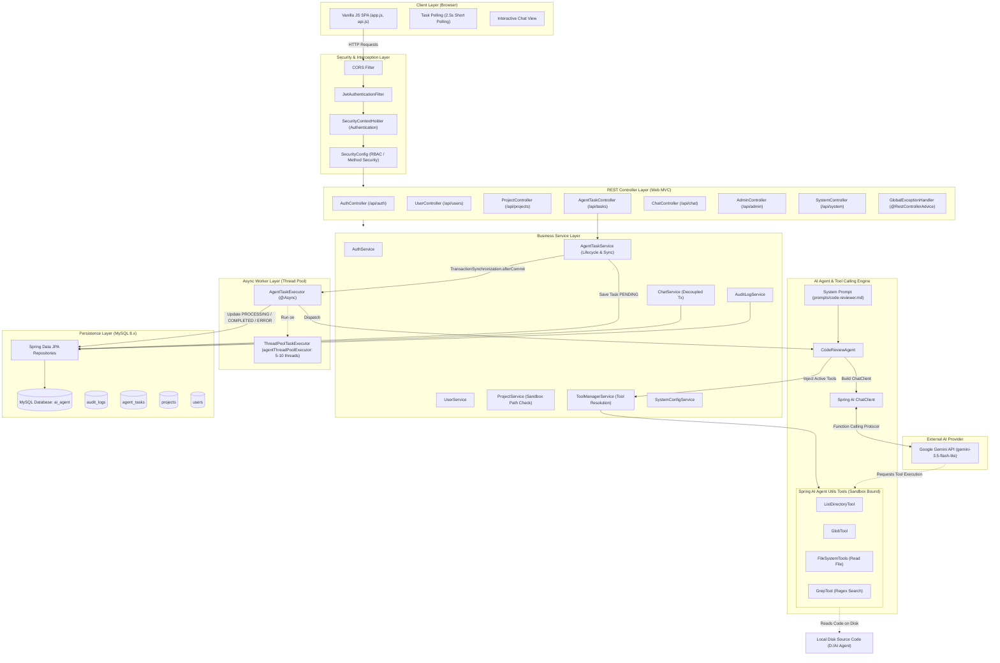
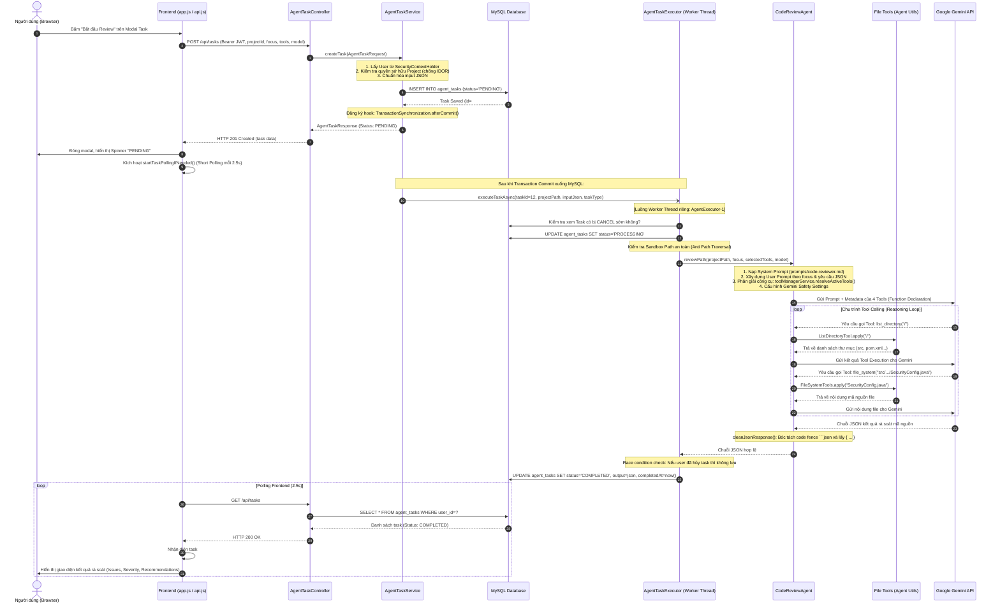

# TÀI LIỆU PHÂN TÍCH TOÀN DIỆN DỰ ÁN SOOPI AI AGENT CODE REVIEWER
### CẨM NANG ÔN TẬP VÀ CHUẨN BỊ PHỎNG VẤN BACKEND INTERN / FRESHER

---

## MỤC LỤC
1. **EXECUTIVE SUMMARY (TỔNG QUAN DỰ ÁN)**
2. **DANH MỤC CÔNG NGHỆ & ĐỐI CHIẾU SOURCE CODE**
3. **BẢNG MA TRẬN PHÂN LOẠI TÍNH NĂNG (MINH BẠCH & TRUNG THỰC)**
4. **PHÂN TÍCH KIẾN TRÚC HỆ THỐNG & SƠ ĐỒ THỰC TẾ**
5. **PHÂN TÍCH CHUYÊN SÂU LUỒNG CODE REVIEW (TỪNG BƯỚC CỤ THỂ KÈM CODE)**
6. **PHÂN TÍCH CƠ CHẾ XÁC THỰC, PHÂN QUYỀN VÀ BẢO MẬT HỆ THỐNG**
7. **GIẢI THÍCH CÔNG NGHỆ CỐT LÕI & CÁCH BẢO VỆ KHI PHỎNG VẤN**
8. **ĐÁNH GIÁ CHẤT LƯỢNG SOURCE CODE (CODE QUALITY & ARCHITECTURE REVIEW)**
9. **KỊCH BẢN GIỚI THIỆU DỰ ÁN KHI PHỎNG VẤN (30 GIÂY - 2 PHÚT - 5 PHÚT)**
10. **BỘ 25 CÂU HỎI PHỎNG VẤN PHẢN BIỆN CHUYÊN SÂU & ĐÁP ÁN MẪU**
11. **LỘ TRÌNH ĐỌC SOURCE CODE DÀNH RIÊNG CHO BẠN**

---

# 1. EXECUTIVE SUMMARY (TỔNG QUAN DỰ ÁN)

- **Tên dự án**: **Soopi - AI Agent Code Reviewer Platform** (Nền tảng Tác tử AI Đánh giá Mã nguồn).
- **Package gốc**: `prj.anhzxje.aiagent`
- **Mục tiêu chính**: Cung cấp giải pháp tự động hóa rà soát mã nguồn (Code Review), phát hiện sớm các lỗ hổng bảo mật (OWASP, SQLi, Path Traversal), lỗi logic (Null pointer, tài nguyên rò rỉ, ngoại lệ nuốt chửng), và thắt nút cổ chai hiệu năng trong các dự án phần mềm mà không cần gửi toàn bộ mã nguồn vào cửa sổ ngữ cảnh LLM.
- **Bài toán thực tế giải quyết**: 
  1. Trong quy trình phát triển phần mềm, việc Code Review thủ công tốn nhiều thời gian của Senior/Tech Lead.
  2. Các công cụ SAST (Static Application Security Testing) truyền thống như SonarQube chỉ kiểm tra rule cứng nhắc, thiếu khả năng hiểu ngữ cảnh nghiệp vụ và không đưa ra giải pháp sửa lỗi trực quan.
  3. Các chatbot AI thông thường (ChatGPT/Claude web) đòi hỏi lập trình viên phải copy-paste từng đoạn code thủ công; nếu dự án lớn hàng chục/hàng trăm file thì vượt quá context window hoặc gây tốn kém chi phí token cực lớn.
  4. Soopi giải quyết bài toán này bằng cách đóng vai trò một **Autonomous AI Agent** trang bị **Tool Calling**: AI tự định hướng, tự duyệt cây thư mục, tìm kiếm pattern bằng regex (`grep`), tự mở đúng file cần đọc và phân tích có bằng chứng.
- **Đối tượng sử dụng**:
  - **Lập trình viên (Developer)**: Tự rà soát code của mình trước khi tạo Pull Request, hỏi đáp kiến trúc dự án thông qua tính năng Chatbot gắn workspace.
  - **Trưởng nhóm / Quản trị viên (Team Lead / Admin)**: Quản lý thành viên, kiểm duyệt lịch sử rà soát, kiểm soát các công cụ AI được phép chạy, giám sát lỗi và nhật ký kiểm toán hệ thống.

---

# 2. DANH MỤC CÔNG NGHỆ & ĐỐI CHIẾU SOURCE CODE

| Phân hệ / Thư viện | Phiên bản / Chi tiết | Vai trò trong hệ thống | Bằng chứng source code |
|---|---|---|---|
| **Java Platform** | Java 21 LTS | Nền tảng ngôn ngữ chính, tận dụng Pattern Matching, Virtual Thread compatibility, Record types. | `pom.xml` (`<java.version>21</java.version>`) |
| **Framework nền tảng** | Spring Boot Starter Parent | Quản lý vòng đời ứng dụng, Dependency Injection, Inversion of Control, Auto-configuration. | `pom.xml` (`spring-boot-starter-parent`), `AiagentApplication.java` |
| **Spring AI Core** | Spring AI 2.0.0 (`spring-ai-bom`) | Cung cấp trừu tượng hóa `ChatClient`, `Prompt`, gọi LLM đa nhà cung cấp và cơ chế Function/Tool Calling. | `pom.xml`, `CodeReviewAgent.java`, `ChatService.java` |
| **Google Gemini Model** | `spring-ai-starter-model-google-genai` | Cung cấp Client kết nối Google Gemini API (model mặc định: `gemini-3.5-flash-lite`, hỗ trợ thêm `gemini-3.1-flash-lite`, `gemini-2.5-flash`). | `application.yml`, `CodeReviewAgent.java`, `SystemConfigService.java` |
| **AI Agent File Tools** | `spring-ai-agent-utils:0.10.0` | Thư viện cung cấp các Function Callings: `ListDirectoryTool`, `GlobTool`, `FileSystemTools`, `GrepTool`. | `pom.xml`, `ToolManagerService.java` (import `org.springaicommunity.agent.tools.*`) |
| **Cơ sở dữ liệu** | MySQL 8.x + `mysql-connector-j` | Lưu trữ dữ liệu quan hệ: người dùng, dự án, tác vụ AI, phiên hội thoại, tin nhắn, nhật ký audit log. | `application.yml`, `pom.xml`, `docker-compose.yml` |
| **Tầng dữ liệu ORM** | Spring Data JPA + Hibernate 6 | Thao tác CSDL thông qua Repository Pattern, tự động sinh schema DDL (`ddl-auto: update`), quản lý transaction. | `application.yml`, package `prj.anhzxje.aiagent.repository` |
| **Bảo mật & Phân quyền** | Spring Security 6 | Bảo vệ endpoints, quản lý phiên Stateless, chặn CSRF, phân quyền theo vai trò (`ROLE_USER`, `ROLE_ADMIN`). | `SecurityConfig.java`, `CustomUserDetails.java` |
| **Mã hóa Token** | JJWT 0.12.5 (`jjwt-api`, `jjwt-impl`, `jjwt-jackson`) | Sinh và xác thực JSON Web Token ký thuật toán HMAC-SHA256, truyền tải danh tính người dùng độc lập. | `pom.xml`, `JwtTokenProvider.java`, `JwtAuthenticationFilter.java` |
| **Mã hóa mật khẩu** | BCrypt (`BCryptPasswordEncoder`) | Băm mật khẩu người dùng với salt ngẫu nhiên, chống tấn công Rainbow table. | `SecurityConfig.java`, `AuthService.java` |
| **Xử lý bất đồng bộ** | Spring `@Async` + `ThreadPoolTaskExecutor` | Xử lý các tác vụ AI rà soát mã nguồn ngầm (tốn từ 5 - 30 giây) mà không làm block luồng HTTP của Web server. | `AgentConfig.java`, `AgentTaskExecutor.java` |
| **Xử lý JSON** | Jackson (`jackson-databind`, `JavaTimeModule`) | Chuyển đổi DTO, chuẩn hóa chuỗi JSON đầu vào/đầu ra của tác vụ, định dạng chuẩn ISO cho `LocalDateTime`. | `AgentConfig.java`, `CodeReviewAgent.java`, `AgentTaskExecutor.java` |
| **Frontend UI** | Vanilla HTML5, CSS3, JavaScript ES6+ (Modular) | Giao diện Single Page Application gọn nhẹ: `api.js`, `app.js`, `projectView.js`, `chatView.js`, `adminView.js`. Không dùng framework nặng. | Thư mục `src/main/resources/static/` |
| **Containerization** | Docker, Docker Compose (Multi-stage build) | Đóng gói ứng dụng vào image Eclipse Temurin 21 JRE Alpine và khởi tạo cụm MySQL 8.0. | `Dockerfile`, `docker-compose.yml` |
| **Kiểm thử tự động** | Spring Boot Starter Test, Mockito, JUnit 5 | Kiểm thử đơn vị và tích hợp (135 test cases) bao phủ Controller, Service, Repository, Security. | Thư mục `src/test/java/prj/anhzxje/aiagent/` |

---

# 3. BẢNG MA TRẬN PHÂN LOẠI TÍNH NĂNG (MINH BẠCH & TRUNG THỰC)

> [!IMPORTANT]
> **Quy tắc phỏng vấn vàng**: Tuyệt đối không nhận những gì dự án chưa làm được. Sự trung thực và khả năng nhận biết giới hạn của hệ thống sẽ gây ấn tượng cực mạnh với Technical Interviewer.

| Tên tính năng | Mô tả chi tiết | Trạng thái kỹ thuật | Bằng chứng mã nguồn / Ghi chú thực tế |
|---|---|:---:|---|
| **Đăng ký / Đăng nhập / Đổi mật khẩu** | Đăng ký tài khoản mới, đăng nhập nhận JWT 24h, mã hóa BCrypt, đổi mật khẩu cá nhân. | **Đã xác minh trong code** | `AuthController.java`, `AuthService.java`, `UserController.java` |
| **Khóa / Mở khóa tài khoản** | Admin khóa tài khoản (`isLocked = true`). Filter lập tức từ chối request của token. | **Đã xác minh trong code** | `CustomUserDetails.isAccountNonLocked()`, `JwtAuthenticationFilter.java`, `AdminController.java` |
| **Quản lý dự án (Project CRUD)** | Tạo, sửa, xem, xóa dự án. Kiểm tra thư mục có thực trên ổ đĩa máy chủ (`Files.isDirectory`). | **Đã xác minh trong code** | `ProjectController.java`, `ProjectService.java` |
| **Xóa dự án tầng sâu (Cascade Delete)** | Khi xóa 1 dự án, tự động xóa sạch toàn bộ tác vụ AI, phiên hội thoại và tin nhắn thuộc dự án đó. | **Đã xác minh trong code** | `ProjectService.deleteProject()` (gọi xóa trên các repository liên quan) |
| **Cách ly dữ liệu (Data Isolation)** | Người dùng chỉ truy cập được dữ liệu của chính mình thông qua `currentUser.getId()`. Chống IDOR. | **Đã xác minh trong code** | Tất cả các method trong `ProjectService`, `AgentTaskService`, `ChatService` |
| **Hàng rào bảo mật Sandbox (Anti Path Traversal)** | Chuẩn hóa đường dẫn (`Path.normalize()`), đối chiếu tiền tố `agent.allowed-paths`. Cấm chứa `..`. | **Đã xác minh trong code** | `ToolManagerService.isPathAllowed()`, `AgentTaskExecutor.isPathAllowed()`, `ProjectService.validateSandboxPath()` |
| **Tác vụ AI Code Review (Async Task)** | Tiếp nhận yêu cầu review, lưu task PENDING, đẩy vào ThreadPool chạy ngầm, gọi LLM, cập nhật COMPLETED/ERROR. | **Đã xác minh trong code** | `AgentTaskController.java`, `AgentTaskService.java`, `AgentTaskExecutor.java` |
| **Chống Race Condition trong Async** | Sử dụng `TransactionSynchronizationManager.afterCommit()` để đảm bảo DB commit xong mới kích hoạt Async Thread. | **Đã xác minh trong code** | `AgentTaskService.java` (dòng 155-164) |
| **Tool Calling động (Dynamic Tool Calling)** | Gắn các tool `list_directory`, `glob`, `file_system`, `grep` từ thư viện Spring AI Agent Utils vào cuộc gọi LLM. | **Đã xác minh trong code** | `ToolManagerService.resolveActiveTools()`, `CodeReviewAgent.java` |
| **Master Switch quản trị Tools** | Admin có thể Bật/Tắt từng công cụ trong CSDL. Người dùng không thể dùng tool mà Admin đã tắt. | **Đã xác minh trong code** | `AdminController.java`, `ToolManagerService.java`, bảng `agent_tool_configs` |
| **Làm sạch JSON Output (Clean JSON)** | Loại bỏ code fence Markdown (````json ... ````), trích xuất chính xác từ dấu `{` đầu đến dấu `}` cuối. | **Đã xác minh trong code** | `CodeReviewAgent.cleanJsonResponse()` |
| **Xử lý lỗi Quota / Rate Limit (429)** | Bắt lỗi `RESOURCE_EXHAUSTED` / `429` từ Gemini để thông báo trực quan yêu cầu đổi model. | **Đã xác minh trong code** | `CodeReviewAgent.java` (dòng 270-280) |
| **Hội thoại AI Chatbot đa lượt** | Chatbot hỗ trợ 2 chế độ: Hỏi đáp chung và Không gian dự án (gắn project context + tool duyệt file). | **Đã xác minh trong code** | `ChatController.java`, `ChatService.java` |
| **Decoupled Transaction trong Chat** | Tách giao dịch DB (lưu user msg) khỏi cuộc gọi I/O LLM (5-30s) để tránh chiếm dụng HikariCP connection. | **Đã xác minh trong code** | `ChatService.sendMessage()` (sử dụng `runInTransaction()`) |
| **Ghim / Bỏ ghim tác vụ (Pin Task)** | Ghim các tác vụ quan trọng lên đầu danh sách hoặc thanh điều hướng. | **Đã xác minh trong code** | `AgentTaskController.togglePin()`, `AgentTaskService.togglePin()` |
| **Hủy tác vụ (Cancel Task)** | Cho phép hủy task đang ở trạng thái PENDING hoặc PROCESSING; có chốt chặn race condition trong thread ngầm. | **Đã xác minh trong code** | `AgentTaskService.cancelTask()`, `AgentTaskExecutor.java` (kiểm tra status CANCELLED) |
| **Chạy lại tác vụ (Retry Task)** | Thiết lập lại task cũ về PENDING và đẩy vào hàng đợi thực thi lại. | **Đã xác minh trong code** | `AgentTaskService.retryTask()` |
| **Nhật ký kiểm toán (Audit Trail)** | Tự động ghi lại IP, hành động nhạy cảm, username, thời gian vào bảng `audit_logs`. | **Đã xác minh trong code** | `AuditLogService.java`, `AuditLog.java`, `AdminController.java` |
| **Tùy chọn giao diện (User Preferences)** | Lưu theme (dark/light), ngôn ngữ, model ưa thích của từng user vào MySQL. | **Đã xác minh trong code** | `UserPreferencesService.java`, `UserPreferences.java` |
| **Short Polling trên Frontend** | Giao diện tự động gửi HTTP GET mỗi 2.5 giây để cập nhật trạng thái tác vụ cho đến khi hoàn tất. | **Đã xác minh trong code** | `app.js` (`startTaskPollingIfNeeded()`, `setInterval(..., 2500)`) |
| **Tác vụ Sửa code (CODE_FIX)** | Sửa trực tiếp lỗi trong file mã nguồn. | **Đã có enum & form nhưng CHƯA HOÀN THIỆN (Fallback)** | `AgentTaskExecutor.dispatchTask()` ghi log: *"TaskType CODE_FIX chưa có agent riêng — fallback sang CODE_REVIEW"*. Hệ thống chỉ là READ-ONLY. |
| **Tác vụ Giải thích code (CODE_EXPLAIN)** | Phân tích sâu luồng thực thi của 1 class. | **Đã có enum & form nhưng CHƯA HOÀN THIỆN (Fallback)** | Fallback sang `CODE_REVIEW` trong `AgentTaskExecutor.java`. |
| **Tác vụ Sinh Test (TEST_GENERATION)** | Tự động viết unit test cho source code. | **Đã có enum & form nhưng CHƯA HOÀN THIỆN (Fallback)** | Fallback sang `CODE_REVIEW` trong `AgentTaskExecutor.java`. |
| **Cơ chế RAG (Retrieval-Augmented Generation)** | Tìm kiếm vector, nhúng embedding, chunking văn bản. | **CHỈ LÀ Ý TƯỞNG / KHÔNG CÓ TRONG CODE** | Codebase **HOÀN TOÀN KHÔNG DÙNG RAG**. Hệ thống dùng **Tool Calling** (Function Calling) đọc file trực tiếp qua filesystem. |
| **Push thông báo thời gian thực (WebSocket / SSE)** | Server tự động push kết quả khi task hoàn thành mà không cần FE gọi liên tục. | **CHƯA TRIỂN KHAI** | Codebase hiện tại dùng cơ chế **Client Short Polling** (2.5s) thay vì WebSocket hay SSE. |
| **Desktop App (Electron)** | Chạy ứng dụng dưới dạng Desktop app native. | **CHỈ NÊU TRONG TÀI LIỆU** | Toàn bộ dự án là Web Application phục vụ qua cổng 8080 của Spring Boot. |

---

# 4. PHÂN TÍCH KIẾN TRÚC HỆ THỐNG & SƠ ĐỒ THỰC TẾ

### 4.1. Sơ đồ kiến trúc tổng thể (Architecture Diagram)



### 4.2. Phân tầng và Trách nhiệm (Separation of Concerns)

1. **Controller Layer**: Tiếp nhận HTTP Request, áp dụng `@Valid` để kiểm tra tính toàn vẹn dữ liệu (Bean Validation), không chứa logic nghiệp vụ, ủy thác hoàn toàn cho Service, trả về HTTP status code tương ứng (200 OK, 201 Created, 204 No Content).
2. **Service Layer**: Trái tim của ứng dụng. Chịu trách nhiệm thực hiện business logic: kiểm tra quyền sở hữu dữ liệu (Data Isolation), kiểm tra bảo mật Sandbox đường dẫn, điều phối transaction (`@Transactional`), gọi audit log.
3. **Async Execution Layer (`AgentTaskExecutor`)**: Tách rời việc thực thi tác vụ nặng khỏi Web thread pool. Chạy trên thread pool độc lập `agentThreadPoolExecutor` (5 core threads, 10 max threads, 50 queue).
4. **Agent Layer (`CodeReviewAgent` + `ToolManagerService`)**: Đóng gói toàn bộ logic tương tác với LLM và Tool Calling. Tạo prompt, phân giải tool được phép, cấu hình SafetySettings của Gemini, làm sạch chuỗi JSON đầu ra.
5. **Persistence Layer (Entity & Repository)**: Ánh xạ quan hệ thực thể (JPA/Hibernate) xuống MySQL. Áp dụng chuẩn snake_case trong CSDL và camelCase trong Java code. Tắt `open-in-view: false` để giải phóng kết nối database ngay sau khi tầng Service kết thúc.

---

# 5. PHÂN TÍCH CHUYÊN SÂU LUỒNG CODE REVIEW (TỪNG BƯỚC CỤ THỂ KÈM CODE)

Đây là kịch bản cốt lõi nhất cần trình bày mạch lạc khi phỏng vấn:



### Chi tiết 13 bước trong Source Code:

#### Bước 1: Thao tác Frontend và gửi HTTP Request
- **File**: `src/main/resources/static/js/app.js` (dòng 1443-1479)
- Người dùng chọn dự án, loại task (`CODE_REVIEW`), trọng tâm (`focus`: security/performance/bug/code_quality), mô hình Gemini và tích chọn các công cụ.
- Gọi `window.apiClient.createTask(...)` gửi HTTP `POST /api/tasks` kèm Header `Authorization: Bearer <jwt_token>`.

#### Bước 2: Dữ liệu Payload gửi đi (DTO)
- **Class**: `AgentTaskRequest` trong [AgentTaskRequest.java](file:///d:/AI%20Agent/aiagent/src/main/java/prj/anhzxje/aiagent/dto/task/AgentTaskRequest.java)
```json
{
  "projectId": 1,
  "type": "CODE_REVIEW",
  "focus": "security",
  "model": "gemini-3.5-flash-lite",
  "selectedTools": ["list_directory", "glob", "file_system", "grep"]
}
```

#### Bước 3: Controller tiếp nhận và kiểm tra hợp lệ
- **Class**: `AgentTaskController` trong [AgentTaskController.java](file:///d:/AI%20Agent/aiagent/src/main/java/prj/anhzxje/aiagent/controller/AgentTaskController.java) (dòng 40-45)
```java
@PostMapping
public ResponseEntity<AgentTaskResponse> createTask(@Valid @RequestBody AgentTaskRequest request) {
    return ResponseEntity.status(HttpStatus.CREATED).body(agentTaskService.createTask(request));
}
```
- Annotation `@Valid` kích hoạt Jakarta Bean Validation kiểm tra các ràng buộc như `@NotNull` trên `projectId` và `type`.

#### Bước 4: Service tạo bản ghi Task và chuẩn hóa Input
- **Class**: `AgentTaskService` trong [AgentTaskService.java](file:///d:/AI%20Agent/aiagent/src/main/java/prj/anhzxje/aiagent/service/AgentTaskService.java) (dòng 80-146)
- Lấy thông tin user hiện tại: `User currentUser = getCurrentUser();` từ `SecurityContextHolder`.
- **Kiểm tra quyền sở hữu (IDOR Guard)**:
```java
if (!project.getUser().getId().equals(currentUser.getId())) {
    throw new ResourceNotFoundException("Không tìm thấy project với id: " + request.getProjectId());
}
```
- Gộp `selectedTools`, `model`, `prompt` thành một JSON object lưu vào trường `input` của bảng `agent_tasks`.
- Lưu thực thể `AgentTask` với trạng thái ban đầu `JobStatus.PENDING`.
- Ghi nhật ký kiểm toán: `auditLogService.log(currentUser.getUsername(), "CREATE_TASK", ...)`.

#### Bước 5: Cơ chế chuyển tiếp Bất đồng bộ chống Race Condition
- **Class**: `AgentTaskService.java` (dòng 155-164)
- **Vấn đề kỹ thuật**: Nếu gọi hàm `@Async` ngay lập tức, thread ngầm có thể thực thi câu lệnh `agentTaskRepository.findById(taskId)` TRƯỚC KHI transaction hiện tại kịp `COMMIT` xuống MySQL -> Dẫn đến lỗi `EntityNotFoundException`.
- **Giải pháp xử lý trong code**:
```java
if (TransactionSynchronizationManager.isActualTransactionActive()) {
    TransactionSynchronizationManager.registerSynchronization(new TransactionSynchronization() {
        @Override
        public void afterCommit() {
            agentTaskExecutor.executeTaskAsync(effectiveTaskId, effectiveProjectPath, effectiveInput, effectiveType);
        }
    });
} else {
    agentTaskExecutor.executeTaskAsync(effectiveTaskId, effectiveProjectPath, effectiveInput, effectiveType);
}
```
- Trả về ngay `AgentTaskResponse` với status `PENDING` (HTTP 201 Created) để giải phóng Web request trong vòng vài millisecond.

#### Bước 6: ThreadPool Worker tiếp nhận tác vụ
- **Class**: `AgentConfig` trong [AgentConfig.java](file:///d:/AI%20Agent/aiagent/src/main/java/prj/anhzxje/aiagent/config/AgentConfig.java) (dòng 27-36)
- Bean `agentThreadPoolExecutor` cấp phát một Thread từ pool (tiền tố `AgentExecutor-1`, `AgentExecutor-2`...).
- **Class**: `AgentTaskExecutor` trong [AgentTaskExecutor.java](file:///d:/AI%20Agent/aiagent/src/main/java/prj/anhzxje/aiagent/service/AgentTaskExecutor.java) (dòng 50-70).

#### Bước 7: Kiểm tra Hủy sớm & Cập nhật Trạng thái PROCESSING
- **Class**: `AgentTaskExecutor.java` (dòng 59-69)
- Kiểm tra sớm: Nếu người dùng đã bấm hủy task trong lúc chờ hàng đợi (`status == CANCELLED`), kết thúc ngay.
- Đổi trạng thái: `updateStatus(taskId, JobStatus.PROCESSING);` -> Ghi xuống MySQL.

#### Bước 8: Kiểm tra Bảo mật Thư mục (Sandbox Path Validation)
- **Class**: `AgentTaskExecutor.java` (dòng 126-135, method `isPathAllowed` dòng 231-260)
```java
Path normalizedTarget = Path.of(pathStr).toAbsolutePath().normalize();
if (normalizedTarget.toString().contains("..")) return false;
for (String allowed : allowedPaths) {
    Path normalizedAllowed = Path.of(allowed).toAbsolutePath().normalize();
    if (normalizedTarget.startsWith(normalizedAllowed)) return true;
}
```
- Ngăn chặn hoàn toàn việc chỉ định các thư mục hệ thống như `C:\Windows` hay `/etc/passwd`.

#### Bước 9: Gọi CodeReviewAgent & Tạo Prompt Chuyên biệt
- **Class**: `CodeReviewAgent` trong [CodeReviewAgent.java](file:///d:/AI%20Agent/aiagent/src/main/java/prj/anhzxje/aiagent/agent/CodeReviewAgent.java) (dòng 113-209)
- Xây dựng `focusInstruction` theo từng danh mục: `security` (auth, token, leak), `performance` (N+1 query, memory leak), `bug` (null pointer, logic errors), `code_quality` (clean code, naming convention).
- Nạp System Prompt định danh từ [prompts/code-reviewer.md](file:///d:/AI%20Agent/aiagent/src/main/resources/prompts/code-reviewer.md).
- Ràng buộc cấu trúc đầu ra: Bắt buộc trả về JSON thuần có cấu trúc `{ summary, issues: [{severity, category, file, description, recommendation}], suggestions }` bằng tiếng Việt.

#### Bước 10: Phân giải Công cụ Duyệt file (Dynamic Tool Calling Resolution)
- **Class**: `ToolManagerService` trong [ToolManagerService.java](file:///d:/AI%20Agent/aiagent/src/main/java/prj/anhzxje/aiagent/service/ToolManagerService.java) (dòng 152-218)
- Lấy danh sách công cụ đang được bật ở cấp Admin từ MySQL (`toolConfigRepository.findByEnabledTrue()`).
- Giao thoa (Intersection) với danh sách công cụ mà user yêu cầu -> Chống việc user lạm quyền bật tool chưa được phê duyệt.
- Khởi tạo đối tượng Tool kèm sandbox `workingDirectory(basePath)` hoặc `allowedDirectory(basePath)`:
  - `ListDirectoryTool`: Duyệt cây thư mục.
  - `GlobTool`: Quét file theo mẫu wildcard.
  - `FileSystemTools`: Đọc nội dung file source code.
  - `GrepTool`: Tìm kiếm chuỗi/regex trên codebase.
- Gắn vào `promptSpec.tools(dynamicTools.toArray())`.

#### Bước 11: Thực thi Tác tử AI (Reasoning Loop) & Bắt lỗi Quota
- Spring AI gửi prompt và danh sách định nghĩa Tools cho Google Gemini.
- Gemini phân tích và quyết định gọi các Tool để tự khám phá dự án (Reasoning + Function Calling).
- **Class**: `CodeReviewAgent.java` (dòng 268-282)
- Nếu gặp lỗi giới hạn hạn ngạch (Rate Limit 429 / RESOURCE_EXHAUSTED), bắt lỗi và thông báo chi tiết:
```java
if (err.contains("429") || err.contains("RESOURCE_EXHAUSTED") || err.contains("Quota exceeded")) {
    throw new RuntimeException("Mô hình " + effectiveModel + " đã đạt giới hạn hạn mức (Rate limit/Quota). Vui lòng đổi sang mô hình khác hoặc thử lại sau vài giây.");
}
```

#### Bước 12: Làm sạch kết quả & Lưu Database
- **Class**: `CodeReviewAgent.cleanJsonResponse()` (dòng 294-317)
  - Cắt bỏ tiền tố ````json và hậu tố ````.
  - Cắt chính xác chuỗi con từ dấu `{` đầu tiên đến dấu `}` cuối cùng để loại bỏ mọi lời chào hoặc văn bản dạo đầu/kết thúc vô tình sinh ra từ LLM.
- **Class**: `AgentTaskExecutor.java` (dòng 144-157)
  - Kiểm tra race condition lần cuối: Nếu người dùng đã bấm Cancel trong lúc Gemini đang phân tích, không ghi đè kết quả.
  - Nếu bình thường, gọi `completeTask(taskId, result)`: cập nhật `status = COMPLETED`, `output = result`, `completedAt = LocalDateTime.now()`.
  - Nếu có exception, gọi `failTask(taskId, error)`: cập nhật `status = ERROR`, `errorMessage = e.getMessage()`.

#### Bước 13: Frontend Polling hiển thị kết quả
- **File**: `src/main/resources/static/js/app.js` (dòng 635-669)
- Hàm `startTaskPollingIfNeeded()` chạy vòng lặp `setInterval` mỗi 2.5 giây gọi API `GET /api/tasks`.
- Khi phát hiện trạng thái task chuyển thành `COMPLETED`, giao diện tự động xóa interval, dừng loading spinner, parse JSON từ trường `output` và hiển thị trực quan các thẻ vi phạm (Issues) kèm mức độ nghiêm trọng (High, Medium, Low) và đoạn mã đề xuất sửa lỗi.

---

# 6. PHÂN TÍCH CƠ CHẾ XÁC THỰC, PHÂN QUYỀN VÀ BẢO MẬT HỆ THỐNG

### 6.1. Kiến trúc Xác thực JWT (Stateless Authentication)
1. **Quy trình Đăng nhập**:
   - Client gửi `POST /api/auth/login` với `{ username, password }`.
   - `AuthService` chuyển giao cho `AuthenticationManager.authenticate(...)`.
   - `DaoAuthenticationProvider` gọi `CustomUserDetailsService.loadUserByUsername()` truy vấn bảng `users`.
   - So khớp mật khẩu đã hash bằng `BCryptPasswordEncoder.matches()`.
   - Nếu tài khoản có `isLocked = true`, `CustomUserDetails.isAccountNonLocked()` trả về `false` -> Quăng ngoại lệ `LockedException` (chặn đăng nhập).
   - Nếu hợp lệ, `JwtTokenProvider.generateToken(username, role)` tạo chuỗi token có thời hạn 24 giờ (86.400.000 ms), ký HMAC-SHA256 với secret key tối thiểu 256 bits (`jwt.secret`).

2. **Quy trình Lọc Yêu cầu (`JwtAuthenticationFilter`)**:
   - Kế thừa `OncePerRequestFilter`, chặn trước `UsernamePasswordAuthenticationFilter`.
   - Trích xuất token từ header `Authorization: Bearer <token>`.
   - Gọi `jwtTokenProvider.validateToken(jwt)` (bắt các lỗi: `MalformedJwtException`, `ExpiredJwtException`, `UnsupportedJwtException`).
   - Lấy `username`, tải `UserDetails`, kiểm tra `userDetails.isAccountNonLocked()`.
   - Nạp `UsernamePasswordAuthenticationToken` vào `SecurityContextHolder.getContext().setAuthentication(...)`.

3. **Phân quyền dựa trên Role (RBAC)**:
   - Trong `CustomUserDetails`, role của user được gắn tiền tố `ROLE_` (`ROLE_USER`, `ROLE_ADMIN`).
   - Cấu hình `@EnableMethodSecurity` trong `SecurityConfig`.
   - Các API quản trị trong `AdminController` được bảo vệ bằng `@PreAuthorize("hasRole('ADMIN')")`. Nếu tài khoản có role `USER` gọi vào sẽ bị Spring Security quăng `AccessDeniedException` và `GlobalExceptionHandler` trả về mã lỗi **403 Forbidden**.

### 6.2. An toàn Dữ liệu & Độc lập Người dùng (Data Isolation / Multi-tenancy)
- Toàn bộ các API nghiệp vụ (`Project`, `AgentTask`, `ChatConversation`, `UserPreferences`) không bao giờ tin tưởng ID người dùng từ request body hay path variable của client.
- Hệ thống luôn trích xuất danh tính đáng tin cậy từ `SecurityContextHolder.getContext().getAuthentication().getPrincipal()`.
- Mọi câu lệnh truy vấn CSDL đều có điều kiện kiểm tra quyền sở hữu:
  - `project.getUser().getId().equals(currentUser.getId())`
  - `agentTask.getUser().getId().equals(currentUser.getId())`
  - `conversation.getUser().getId().equals(currentUser.getId())`
- **Ý nghĩa bảo mật**: Ngăn chặn hoàn toàn lỗ hổng **IDOR (Insecure Direct Object Reference)**, đảm bảo người dùng A không thể xem, sửa hoặc xóa dự án và tác vụ của người dùng B.

### 6.3. Phòng chống Tấn công Vượt thư mục (Anti Path Traversal Sandbox)
- **Rủi ro thực tế**: AI Agent có khả năng gọi tool đọc file trên hệ thống tệp cục bộ của máy chủ. Kẻ tấn công có thể tạo dự án với đường dẫn `../../../../Windows/System32` hoặc `/etc` để đọc trộm file cấu hình, ssh key, mật khẩu hệ điều hành.
- **Cơ chế 3 lớp bảo vệ trong dự án**:
  1. **Lớp 1 (Project Service)**: Khi người dùng thêm dự án, `ProjectService.validateSandboxPath()` kiểm tra thư mục đó phải tồn tại trên ổ đĩa và phải là thư mục con nằm trong danh sách trắng `agent.allowed-paths`.
  2. **Lớp 2 (Executor Validation)**: Trước khi kích hoạt Agent, `AgentTaskExecutor.isPathAllowed()` chuẩn hóa đường dẫn `Path.of(path).toAbsolutePath().normalize()` và kiểm tra chuỗi không được chứa `..`.
  3. **Lớp 3 (Tool Instance Binding)**: Khi khởi tạo các công cụ trong `ToolManagerService.resolveActiveTools()`, truyền biến `basePath` vào `workingDirectory(basePath)` và `allowedDirectory(basePath)`. Thư viện `spring-ai-agent-utils` sẽ giới hạn vùng hoạt động của Tool Calling trong thư mục này.

---

# 7. GIẢI THÍCH CÔNG NGHỆ CỐT LÕI & CÁCH BẢO VỆ KHI PHỎNG VẤN

### 7.1. Java 21 & Spring Boot 3.x
- **Tại sao cần**: Java 21 cung cấp hiệu năng tối ưu, tính năng Pattern Matching cho `switch` (được sử dụng trực tiếp trong `CodeReviewAgent.java` và `AgentTaskExecutor.dispatchTask()`), cấu trúc `record` cho DTO bất biến (`PreparedChatContext`). Spring Boot 3.x cung cấp nền tảng chuẩn mực cho enterprise API, tích hợp tự động với Hibernate 6 và Spring AI.
- **Bảo vệ khi phỏng vấn**: Nêu rõ cách Spring Boot quản lý IoC/DI giúp tách biệt các tầng Controller -> Service -> Repository; giải thích việc cấu hình `open-in-view: false` trong `application.yml` để giải phóng kết nối CSDL ngay sau tầng Service, tránh việc connection pool bị giữ quá lâu.

### 7.2. Spring AI & ChatClient
- **Tại sao cần**: Trước đây việc kết nối LLM trong Java rất phức tạp (phải tự viết HTTP Client gọi OpenAI/Gemini REST API, tự parse JSON). Spring AI chuẩn hóa toàn bộ giao tiếp này thông qua `ChatClient`, tương tự như `RestClient` hay `WebClient`.
- **Cơ chế hoạt động**: `ChatClient` hỗ trợ Fluent API (`prompt().system(...).user(...).tools(...).call().content()`). Nó tự động ánh xạ Java method/class thành định dạng JSON Schema Function Calling của Google Gemini.

### 7.3. Tool Calling (Function Calling) vs. Đưa Toàn Bộ Code Vào Prompt
- **Vấn đề của việc đưa toàn bộ code vào prompt**:
  - Gặp giới hạn Token Context Window nếu dự án có hàng trăm file.
  - Tốn kém chi phí token cực lớn (mỗi lần review phải gửi hàng trăm ngàn token).
  - Tăng độ trễ phản hồi (latency cao).
  - Gây hiện tượng "Needle In A Haystack" (LLM bị quá tải thông tin, dễ sinh ảo giác và bỏ sót lỗi logic quan trọng).
- **Ưu điểm vượt trội của Tool Calling**:
  - AI hoạt động như một kỹ sư thực thụ: Đầu tiên AI gọi `list_directory` để xem cấu trúc tổng quan; sau đó dùng `glob` tìm file quan trọng (`pom.xml`, Controller, Service); tiếp tục dùng `grep` tìm các pattern nhạy cảm (như hardcoded password, SQL injection); và cuối cùng chỉ dùng `file_system` mở đúng những file nghi vấn để đọc và kết luận.
  - Tiết kiệm 80-90% lượng token tiêu thụ.

### 7.4. Phân biệt Rõ Ràng: Tool Calling KHÔNG PHẢI là RAG
- **Câu hỏi phỏng vấn bẫy**: *"Hệ thống của bạn có phải là RAG không?"*
- **Câu trả lời chuẩn**:
  > *"Dự án của em KHÔNG PHẢI là RAG. Hệ thống hoạt động theo cơ chế **Autonomous AI Agent với Function / Tool Calling**. RAG (Retrieval-Augmented Generation) đòi hỏi việc tiền xử lý mã nguồn: chia nhỏ văn bản (Chunking), chuyển đổi thành vector qua Embedding Model, lưu vào Vector Database (như Pinecone, Milvus, PgVector), và tìm kiếm tương đồng theo Cosine Similarity. Trong khi đó, hệ thống của em không sử dụng Vector DB, mà cung cấp các công cụ tương tác trực tiếp với File System (`list_directory`, `glob`, `file_system`, `grep`). LLM đóng vai trò bộ não suy luận (Reasoning Engine) để tự quyết định khi nào cần gọi công cụ nào nhằm khám phá mã nguồn trên ổ đĩa."*

### 7.5. Xử lý Bất đồng bộ & Quản trị Thread Pool
- **Tại sao cần**: Thời gian gọi Gemini LLM kèm Tool Calling dao động từ 10 đến 45 giây. Nếu xử lý đồng bộ trên HTTP Request thread của Tomcat:
  - Gây nghẽn Tomcat Worker Threads (mặc định chỉ có 200 threads).
  - Khi có 10-20 người dùng gửi yêu cầu đồng thời, toàn bộ website sẽ bị treo (HTTP 504 Gateway Timeout).
- **Cách giải quyết**:
  - Cấu hình `@EnableAsync` và định nghĩa `ThreadPoolTaskExecutor` chuyên dụng trong `AgentConfig.java`: `corePoolSize = 5`, `maxPoolSize = 10`, `queueCapacity = 50`.
  - Luồng HTTP chỉ làm nhiệm vụ lưu task trạng thái `PENDING` xuống DB rồi trả về ngay HTTP 201 Created cho Client. Quá trình phân tích nặng được đẩy cho Worker Thread ngầm xử lý.

### 7.6. Decoupled Transaction Pattern trong ChatService
- **Điểm sáng kiến trúc**: Trong `ChatService.java`, việc gọi LLM được tách hoàn toàn ra khỏi Transaction của Database:
  - Giai đoạn 1 (DB Tx): Lưu tin nhắn User vào CSDL -> Commit ngay lập tức để giải phóng kết nối database về lại HikariCP Pool.
  - Giai đoạn 2 (Non-Tx I/O): Gọi API Gemini LLM + Tool Calling (mất 5-30 giây) hoàn toàn NGOÀI transaction.
  - Giai đoạn 3 (DB Tx): Sau khi LLM trả về, mở một transaction ngắn thứ hai để lưu câu trả lời của AI và Audit Log.
- **Ý nghĩa**: Ngăn chặn triệt để nguy cơ cạn kiệt Connection Pool của HikariCP (`Connection pool starvation`).

---

# 8. ĐÁNH GIÁ CHẤT LƯỢNG SOURCE CODE (CODE QUALITY & ARCHITECTURE REVIEW)

Dưới đây là các vấn đề thực tế được phát hiện khi phân tích source code, được phân loại rõ ràng phục vụ cho việc trả lời các câu hỏi *"Nếu có thêm thời gian, bạn sẽ cải thiện điều gì?"*:

### Vấn đề 1: Chưa hoàn thiện các Agent chuyên biệt cho `CODE_FIX`, `CODE_EXPLAIN`, `TEST_GENERATION`
- **Mức độ nghiêm trọng**: Trung bình (Medium)
- **Vị trí**: [AgentTaskExecutor.java](file:///d:/AI%20Agent/aiagent/src/main/java/prj/anhzxje/aiagent/service/AgentTaskExecutor.java#L177-L192)
- **Bằng chứng code**:
  ```java
  case CODE_FIX -> {
      log.warn("TaskType CODE_FIX chưa có agent riêng — fallback sang CODE_REVIEW");
      yield codeReviewAgent.reviewPath(projectPath, focus, selectedTools, model);
  }
  ```
- **Ảnh hưởng**: Người dùng chọn chức năng Fix code hoặc Sinh test trên giao diện nhưng kết quả trả về thực tế vẫn là một bản Code Review.
- **Hướng cải tiến**: Tách thêm các Agent chuyên biệt: `CodeFixAgent` (kèm System Prompt sinh git diff / patch), `TestGenerationAgent` (System Prompt sinh mã JUnit/Mockito), hoặc trang bị thêm `WriteFileTool` có cơ chế phê duyệt (Human-in-the-loop).
- **Mức độ ưu tiên**: Cao.

### Vấn đề 2: Cơ chế Realtime dựa trên Client Short Polling (chưa dùng WebSocket / SSE)
- **Mức độ nghiêm trọng**: Thấp - Trung bình (Low - Medium)
- **Vị trí**: `src/main/resources/static/js/app.js` (dòng 640 `setInterval(..., 2500)`)
- **Bằng chứng code**: Client gửi HTTP GET `/api/tasks` liên tục mỗi 2.5 giây cho đến khi task hoàn thành.
- **Ảnh hưởng**: Tạo ra lượng request dư thừa lên server khi có nhiều người dùng cùng lúc, tiêu tốn băng thông và tài nguyên CPU.
- **Hướng cải tiến**: Nâng cấp sang **Server-Sent Events (SSE)** hoặc **WebSocket (STOMP)** để Backend chủ động đẩy thông báo trạng thái `PROCESSING -> COMPLETED` xuống Frontend ngay khi hoàn thành.
- **Mức độ ưu tiên**: Trung bình.

### Vấn đề 3: Thiếu Pagination (Phân trang) trên một số API danh sách
- **Mức độ nghiêm trọng**: Trung bình (Medium)
- **Vị trí**: `AgentTaskController.getMyTasks()`, `ProjectController.getMyProjects()`, `AdminController.getAllTasks()`
- **Bằng chứng code**: `agentTaskRepository.findByUserIdOrderByCreatedAtDesc(...)` trả về toàn bộ danh sách `List<AgentTask>` mà không truyền đối tượng `Pageable`.
- **Ảnh hưởng**: Nếu một tài khoản sử dụng lâu dài và có hàng ngàn task, việc load toàn bộ thực thể lên bộ nhớ RAM (JVM Heap) sẽ gây suy giảm hiệu năng và nguy cơ `OutOfMemoryError`.
- **Hướng cải tiến**: Sử dụng `Pageable`, `PageRequest.of(page, size)` và trả về đối tượng `Page<AgentTaskResponse>`.
- **Mức độ ưu tiên**: Cao.

### Vấn đề 4: Giới hạn của In-Memory Task Cancellation
- **Mức độ nghiêm trọng**: Thấp (Low)
- **Vị trí**: `AgentTaskService.cancelTask()` và `AgentTaskExecutor.java`
- **Bằng chứng code**: Khi user bấm Hủy task, hệ thống đổi trạng thái trong CSDL thành `CANCELLED`. Tuy nhiên, nếu luồng Gemini đang thực hiện cuộc gọi HTTP blocking, luồng này không thể bị ngắt ngay lập tức (Thread Interrupt) mà phải đợi cuộc gọi kết thúc mới kiểm tra lại status và bỏ qua kết quả.
- **Ảnh hưởng**: Lãng phí quota gọi API trong lúc task đã bị hủy.
- **Hướng cải tiến**: Lưu trữ đối tượng `CompletableFuture` hoặc `Future<?>` vào một `ConcurrentHashMap` theo `taskId` để có thể gọi `future.cancel(true)` khi nhận được tín hiệu hủy.
- **Mức độ ưu tiên**: Thấp.

---

# 9. KỊCH BẢN GIỚI THIỆU DỰ ÁN KHI PHỎNG VẤN

### G1. Bản giới thiệu 30 giây (Elevator Pitch)
> *"Chào anh/chị, dự án nổi bật nhất của em là **Soopi - Nền tảng Tác tử AI Đánh giá Mã nguồn (AI Agent Code Reviewer)** xây dựng trên nền tảng **Java 21**, **Spring Boot 3.x** và **Spring AI**. Khác với các chatbot thông thường chỉ đọc text cố định, Soopi hoạt động như một **Autonomous AI Agent** được trang bị **Tool Calling**: AI có thể tự duyệt cây thư mục, tìm kiếm pattern bằng regex và đọc trực tiếp các file mã nguồn cục bộ để phát hiện lỗ hổng bảo mật và lỗi logic với độ chính xác cao mà không cần gửi toàn bộ project vào prompt. Về mặt backend, em tối ưu hệ thống với xử lý bất đồng bộ ThreadPool, phân quyền Spring Security JWT, chống Race Condition khi lưu task và cơ chế Decoupled Transaction để tránh nghẽn kết nối Database."*

### G2. Bản giới thiệu 1–2 phút (Phỏng vấn Tiêu chuẩn)
> *"Chào anh/chị, em định hướng phát triển sự nghiệp trở thành một Backend Developer chuyên sâu về hệ sinh thái Java và Spring Boot. Để giải quyết bài toán tốn thời gian khi rà soát mã nguồn thủ công và giới hạn context-window của các chatbot thông thường, em đã phát triển dự án **Soopi - Nền tảng Tác tử AI Đánh giá Mã nguồn**.*
>
> *Hệ thống được thiết kế theo kiến trúc phân tầng chuẩn mực:*
> - *Tầng bảo mật sử dụng **Spring Security 6** và **JWT (HMAC-SHA256)**, phân tách nghiêm ngặt quyền hạn giữa `ROLE_USER` và `ROLE_ADMIN`, kèm cơ chế khóa tài khoản tức thì và bảo vệ chống tấn công IDOR.*
> - *Để đảm bảo an toàn máy chủ, em thiết kế **Anti Path Traversal Sandbox** kiểm tra chuẩn hóa đường dẫn, ngăn AI đọc file nhạy cảm ngoài phạm vi cho phép.*
> - *Điểm nhấn kỹ thuật lớn nhất của dự án là việc ứng dụng **Spring AI kết hợp Google Gemini và Tool Calling**. Thay vì nhồi nhét mã nguồn vào prompt, AI được cấp 4 công cụ duyệt file an toàn (`list_directory`, `glob`, `file_system`, `grep`) để tự suy luận và khám phá codebase.*
> - *Vì các tác vụ AI tốn từ 10 đến 30 giây, em đã xây dựng luồng **xử lý bất đồng bộ (@Async)** với một `ThreadPoolTaskExecutor` chuyên dụng, áp dụng kỹ thuật `TransactionSynchronizationManager.afterCommit()` để loại bỏ hoàn toàn hiện tượng Race Condition giữa transaction database và worker thread.*
>
> *Qua dự án này, em đã làm chủ kỹ năng thiết kế RESTful API chuẩn mực, xử lý đa luồng, tối ưu hóa giao dịch CSDL và có kinh nghiệm thực chiến quý giá với xu hướng AI Agent mới nhất hiện nay."*

### G3. Bản giải thích kỹ thuật 3–5 phút (Đi sâu vào Chi tiết Kiến trúc)
*(Trình bày theo 4 trục: 1. Luồng Request Async -> 2. Tích hợp AI & Tool Calling -> 3. Tối ưu Giao dịch Database -> 4. Bảo mật Sandbox).*
*(Sử dụng nội dung chi tiết tại Mục 5, 6, 7 ở trên để thuyết trình).*

---

# 10. BỘ 25 CÂU HỎI PHỎNG VẤN PHẢN BIỆN CHUYÊN SÂU & ĐÁP ÁN MẪU

#### Câu 1: Tại sao bạn chọn Spring Boot và Spring AI mà không dùng Python (LangChain/FastAPI) vốn phổ biến hơn cho AI?
- **Đáp án**: Python rất mạnh về nghiên cứu mô hình và PoC, nhưng trong môi trường doanh nghiệp (Enterprise), Java và Spring Boot là xương sống của các hệ sinh thái lớn nhờ tính ổn định, type-safety mạnh mẽ, quản lý dependency chặt chẽ và khả năng mở rộng đa luồng vượt trội. Việc sử dụng **Spring AI** cho phép tích hợp trực tiếp khả năng của AI Agent vào hệ thống backend hiện có của doanh nghiệp mà không cần duy trì hai ngôn ngữ độc lập, giúp thống nhất một ngăn xếp công nghệ (Tech Stack) từ xác thực, CSDL đến AI logic.
- **Dẫn chứng code**: `pom.xml` tích hợp `spring-ai-bom` phiên bản 2.0.0.
- **Câu hỏi đào sâu**: *Spring AI ChatClient khác gì so với việc dùng RestClient gọi trực tiếp API của Google?*

#### Câu 2: Request review code đi qua những lớp nào từ lúc nhận request đến khi trả về?
- **Đáp án**: Đi qua 5 lớp chính:
  1. `JwtAuthenticationFilter`: Xác thực JWT token và nạp danh tính vào SecurityContext.
  2. `AgentTaskController`: Validate DTO đầu vào bằng `@Valid`.
  3. `AgentTaskService`: Kiểm tra quyền sở hữu project, lưu bản ghi `AgentTask` với status `PENDING`, đăng ký hook `afterCommit()`.
  4. `AgentTaskExecutor`: Sau khi commit DB, worker thread từ `ThreadPoolTaskExecutor` chuyển status sang `PROCESSING`, kiểm tra sandbox path.
  5. `CodeReviewAgent`: Gọi `ChatClient` của Spring AI kèm Tool Calling, nhận kết quả, làm sạch JSON và cập nhật `COMPLETED`.
- **Dẫn chứng code**: `AgentTaskController.java -> AgentTaskService.java -> AgentTaskExecutor.java -> CodeReviewAgent.java`.
- **Câu hỏi đào sâu**: *Nếu luồng AI chạy quá lâu và bị timeout thì chuyện gì sẽ xảy ra với HTTP connection của client?*

#### Câu 3: AI trong hệ thống tiếp cận mã nguồn như thế nào?
- **Đáp án**: AI không nhận mã nguồn được dán sẵn trong prompt. Thay vào đó, AI nhận được một System Prompt mô tả vai trò và danh sách các định nghĩa công cụ (Tool Definitions). Mô hình AI tự đóng vai trò điều phối (Autonomous Agent): nó phát ra yêu cầu gọi hàm `list_directory` để xem cây thư mục, sau đó phát ra yêu cầu gọi `file_system` để đọc nội dung file cụ thể. Backend Spring Boot thực thi tool trên máy chủ cục bộ và gửi trả nội dung về cho AI tiếp tục suy luận.
- **Dẫn chứng code**: `ToolManagerService.java` dòng 183-217, `CodeReviewAgent.java` dòng 226-231.
- **Câu hỏi đào sâu**: *Nếu AI rơi vào vòng lặp gọi tool vô tận (Infinite Tool Loop) thì bạn xử lý thế nào?*

#### Câu 4: Tool Calling khác gì với RAG và việc gửi toàn bộ mã nguồn vào prompt?
- **Đáp án**:
  - Gửi toàn bộ mã nguồn: Bị nghẽn context window, chi phí token cực lớn, độ trễ cao, LLM dễ bị quá tải thông tin.
  - RAG: Yêu cầu nhúng vector (embedding) và tìm kiếm ngữ nghĩa theo đoạn (chunk). Nhược điểm với code là mất ngữ cảnh cấu trúc phân cấp (class hierarchy, imports).
  - Tool Calling: AI chủ động duyệt codebase theo nhu cầu logic thực tế (duyệt cây thư mục -> tìm pattern regex -> đọc file đích), giữ nguyên tính toàn vẹn ngữ cảnh cấu trúc dự án.
- **Dẫn chứng code**: `prompts/code-reviewer.md` quy định 4 bước phương pháp luận rà soát.
- **Câu hỏi đào sâu**: *Trong trường hợp nào thì RAG lại ưu việt hơn Tool Calling?*

#### Câu 5: Tại sao bạn cần xử lý bất đồng bộ (@Async) cho tác vụ Review?
- **Đáp án**: Vì một phiên AI Agent tự rà soát codebase qua nhiều lượt Tool Calling tốn từ 10 đến 45 giây. Nếu chạy đồng bộ, luồng HTTP Tomcat sẽ bị giữ chặt (blocked). Tomcat có giới hạn mặc định 200 threads; nếu có vài chục request đồng thời, toàn bộ hệ sinh thái Web sẽ sập (connection pool exhaustion, 504 Gateway Timeout). Xử lý bất đồng bộ giúp giải phóng HTTP request chỉ sau 10-20ms với status 201 Created.
- **Dẫn chứng code**: `AgentConfig.java` cấu hình `agentThreadPoolExecutor`, `AgentTaskExecutor.java` gắn `@Async("agentThreadPoolExecutor")`.
- **Câu hỏi đào sâu**: *Bạn cấu hình các thông số corePoolSize, maxPoolSize, queueCapacity dựa trên tiêu chí nào?*

#### Câu 6: Bạn giải quyết vấn đề Race Condition giữa Transaction Database và Async Thread như thế nào?
- **Đáp án**: Khi một method có `@Transactional` lưu một entity mới, nếu ta gọi method `@Async` ngay trong thân hàm đó, Spring sẽ spawn ngay một worker thread. Worker thread có thể chạy trước khi Database Transaction kịp Commit -> Khi worker thread gọi `findById(taskId)`, CSDL trả về rỗng và phát sinh lỗi `ResourceNotFoundException`. Em đã giải quyết triệt để bằng cách dùng `TransactionSynchronizationManager.registerSynchronization` và chỉ kích hoạt thread ngầm bên trong callback `afterCommit()`.
- **Dẫn chứng code**: `AgentTaskService.java` dòng 155-164.
- **Câu hỏi đào sâu**: *Nếu sau khi transaction commit thành công nhưng server bị mất điện trước khi kịp chạy `afterCommit()` thì task đó sẽ ra sao?*

#### Câu 7: Frontend theo dõi tiến độ của task như thế nào?
- **Đáp án**: Frontend sử dụng cơ chế **Short Polling** bằng JavaScript. Sau khi tạo task thành công, hàm `startTaskPollingIfNeeded()` trong `app.js` khởi tạo một `setInterval` với chu kỳ 2.5 giây gọi API `GET /api/tasks`. Khi phát hiện task chuyển từ `PENDING/PROCESSING` sang `COMPLETED` hoặc `ERROR`, frontend tự động hủy interval (`clearInterval`) và hiển thị kết quả.
- **Dẫn chứng code**: `src/main/resources/static/js/app.js` dòng 635-669.
- **Câu hỏi đào sâu**: *Tại sao bạn không dùng WebSocket hay SSE (Server-Sent Events) thay cho Polling?*

#### Câu 8: Nếu Google Gemini hết quota (Rate Limit 429) thì hệ thống phản ứng ra sao?
- **Đáp án**: Trong `CodeReviewAgent.java`, em chủ động bọc khối `try-catch` khi gọi `promptSpec.call().content()`, phân tích chuỗi lỗi từ root cause. Nếu phát hiện các mã `429`, `RESOURCE_EXHAUSTED` hoặc `Quota exceeded`, hệ thống sẽ quăng một `RuntimeException` với thông báo tiếng Việt rõ ràng, đề xuất người dùng đổi sang mô hình khác hoặc thử lại sau vài giây; đồng thời cập nhật task về trạng thái `ERROR` để cho phép bấm nút "Chạy lại" (Retry).
- **Dẫn chứng code**: `CodeReviewAgent.java` dòng 270-282, `AgentTaskExecutor.java` dòng 295-305.
- **Câu hỏi đào sâu**: *Bạn có cơ chế Circuit Breaker (như Resilience4j) hoặc tự động chuyển đổi sang model dự phòng (Failover) khi gặp lỗi 429 không?*

#### Câu 9: JWT được cấu hình và kiểm tra tính hợp lệ như thế nào trong dự án?
- **Đáp án**:
  - Khi đăng nhập thành công, `JwtTokenProvider` dùng khóa bí mật HMAC-SHA256 (từ `jwt.secret`) tạo chuỗi token chứa `subject` (username) và claim `role` với hạn sống 24h.
  - Trên mỗi request, `JwtAuthenticationFilter` trích xuất chuỗi token từ header `Authorization: Bearer <token>`, gọi `validateToken()` kiểm tra chữ ký và thời hạn.
  - Nếu hợp lệ, filter tải `UserDetails`, kiểm tra xem tài khoản có bị Admin khóa không (`isAccountNonLocked()`), sau đó set đối tượng `UsernamePasswordAuthenticationToken` vào `SecurityContextHolder`.
- **Dẫn chứng code**: `JwtTokenProvider.java`, `JwtAuthenticationFilter.java`, `SecurityConfig.java`.
- **Câu hỏi đào sâu**: *Nếu người dùng đăng xuất, JWT token cũ vẫn còn hạn 24h thì làm sao để vô hiệu hóa nó ngay lập tức (Token Blacklisting)?*

#### Câu 10: Làm thế nào bạn ngăn chặn AI Agent đọc các file nhạy cảm ngoài thư mục dự án (Path Traversal)?
- **Đáp án**: Em xây dựng cơ chế bảo vệ 3 lớp:
  1. `ProjectService` và `AgentTaskExecutor` đều kiểm tra đường dẫn với danh sách trắng `agent.allowed-paths` trong `application.yml`.
  2. Đường dẫn được chuẩn hóa tuyệt đối bằng `Path.toAbsolutePath().normalize()` và kiểm tra nghiêm ngặt không chứa ký tự `..`.
  3. Khi khởi tạo các Tool duyệt file (`FileSystemTools`, `ListDirectoryTool`), truyền `basePath` vào thuộc tính `workingDirectory` và `allowedDirectory` để cô lập phạm vi đọc của thư viện.
- **Dẫn chứng code**: `ToolManagerService.java` dòng 110-133, `AgentTaskExecutor.java` dòng 231-260.
- **Câu hỏi đào sâu**: *Nếu kẻ tấn công tạo một Symlink (Symbolic Link) trỏ ra ngoài thư mục dự án thì hệ thống của bạn có bị qua mặt không?*

#### Câu 11: Nếu dự án có hàng nghìn file thì hệ thống xử lý thế nào để không bị tràn bộ nhớ hay quá tải LLM?
- **Đáp án**:
  - Trong System Prompt (`prompts/code-reviewer.md`), em thiết lập các ràng buộc nghiêm ngặt: Tuyệt đối không đọc các thư mục rác/build (`node_modules`, `target`, `build`, `.git`, `.idea`), bỏ qua các file nhị phân (`.jar`, `.class`, `.png`, `.log`).
  - Hướng dẫn AI chỉ đọc các file cấu trúc trọng tâm (Controller, Service, Entity, Configuration, pom.xml) và dùng `GrepTool` để định vị nhanh đoạn code có vấn đề thay vì đọc toàn bộ tất cả các file.
- **Dẫn chứng code**: `prompts/code-reviewer.md` mục "Rules & Constraints (CRITICAL)".
- **Câu hỏi đào sâu**: *Nếu một file Java duy nhất có kích thước 50MB thì tool đọc file của bạn có bị OutOfMemory không?*

#### Câu 12: Đâu là hạn chế lớn nhất trong thiết kế hiện tại của dự án?
- **Đáp án**: Hạn chế lớn nhất hiện tại là tính năng mới chỉ dừng lại ở mức **READ-ONLY Code Review**. Mặc dù trên giao diện và enum có các loại tác vụ như `CODE_FIX` và `TEST_GENERATION`, nhưng trong backend em mới chỉ triển khai agent cho `CODE_REVIEW` (các loại kia đang fallback về review). Thứ hai là cơ chế giao tiếp tiến độ vẫn dùng Short Polling mỗi 2.5s thay vì Server-Sent Events (SSE).
- **Dẫn chứng code**: `AgentTaskExecutor.java` dòng 177-192.
- **Câu hỏi đào sâu**: *Nếu muốn triển khai tính năng tự động áp dụng bản vá (Code Fix) lên file của người dùng, bạn cần bổ sung những chốt chặn an toàn nào?*

#### Câu 13: Decoupled Transaction trong ChatService giải quyết bài toán gì?
- **Đáp án**: Trong `ChatService`, thời gian gọi Gemini LLM kéo dài từ 5 đến 30 giây. Nếu đặt toàn bộ method `sendMessage` dưới một annotation `@Transactional`, Spring sẽ mượn một kết nối CSDL từ HikariCP Pool và giữ chặt nó trong suốt thời gian chờ API Google phản hồi. Chỉ cần 10 request chat đồng thời sẽ chiếm hết 10 connection mặc định của HikariCP, khiến toàn bộ các API khác (kể cả đăng nhập) bị treo. Em đã tách thành 2 transaction ngắn (lưu tin nhắn User -> Commit giải phóng connection -> Gọi LLM ngoài transaction -> Mở transaction mới lưu tin nhắn AI).
- **Dẫn chứng code**: `ChatService.java` dòng 198-208.
- **Câu hỏi đào sâu**: *Nếu ở bước 3 lưu tin nhắn AI bị lỗi DB thì tin nhắn của User ở bước 1 đã commit rồi có bị rollback không?*

#### Câu 14: Tại sao bạn cấu hình `open-in-view: false` trong `application.yml`?
- **Đáp án**: Mặc định Spring Boot bật `spring.jpa.open-in-view: true` (OSIV), giữ kết nối Database mở cho đến khi View/JSON Serializer render xong. Điều này dễ dẫn đến việc lập trình viên vô tình trigger Lazy Loading ngoài tầng Service (lỗi N+1 query âm thầm) và giữ kết nối CSDL quá lâu. Tắt OSIV giúp giải phóng connection ngay khi Service method hoàn thành, tối ưu hóa tài nguyên kết nối cho hệ thống.
- **Dẫn chứng code**: `src/main/resources/application.yml` dòng 18.
- **Câu hỏi đào sâu**: *Khi tắt OSIV, bạn xử lý lỗi `LazyInitializationException` như thế nào khi truy cập relationship ngoài Service?*

#### Câu 15: Dự án của bạn chống lỗ hổng IDOR (Insecure Direct Object Reference) bằng cách nào?
- **Đáp án**: Toàn bộ các API thao tác dữ liệu theo ID (như `/api/projects/{id}`, `/api/tasks/{id}`, `/api/chat/conversations/{id}`) đều không chỉ dựa vào ID truyền lên mà luôn truy vấn kèm điều kiện `userId` của người dùng đang đăng nhập (lấy trực tiếp từ token đã xác thực qua `SecurityContextHolder`). Nếu ID tồn tại nhưng thuộc về người dùng khác, hệ thống sẽ quăng ngoại lệ `ResourceNotFoundException` để vừa bảo vệ dữ liệu vừa không làm lộ thông tin tài nguyên.
- **Dẫn chứng code**: `ProjectService.java` method `findProjectAndVerifyOwner()`, `AgentTaskService.java` method `findTaskAndVerifyOwner()`.
- **Câu hỏi đào sâu**: *Tại sao khi user cố tình truy cập tài nguyên của người khác, bạn lại trả về 404 Not Found thay vì 403 Forbidden?* (Đáp án: Để tránh kỹ thuật quét ID - Resource Enumeration).

#### Câu 16: Làm sao bạn đảm bảo kết quả từ LLM luôn là một JSON hợp lệ để hệ thống parse được?
- **Đáp án**: Em kết hợp 2 giải pháp:
  1. Kỹ thuật Prompting: Trong System Prompt và User Prompt, quy định bắt buộc: *"Return ONLY a valid JSON object. Do NOT use markdown code blocks. Do NOT add any text before or after the JSON."*
  2. Tiền xử lý chuỗi đầu ra (`cleanJsonResponse`): Tự động cắt bỏ tiền tố ````json và hậu tố ````; đồng thời tìm vị trí của dấu `{` đầu tiên và dấu `}` cuối cùng để substring, loại bỏ hoàn toàn các ký tự đệm ngẫu nhiên trước khi parse vào Jackson ObjectMapper.
- **Dẫn chứng code**: `CodeReviewAgent.java` method `cleanJsonResponse()` dòng 294-317.
- **Câu hỏi đào sâu**: *Nếu LLM bị cắt ngang do đạt max-token limit khiến JSON bị đứt đoạn giữa chừng thì hàm của bạn xử lý ra sao?*

#### Câu 17: Cơ chế Cascading Deletion khi xóa một Project được bạn xử lý như thế nào?
- **Đáp án**: Em không phụ thuộc vào `cascade = CascadeType.REMOVE` ở mức entity JPA để tránh việc sinh ra hàng loạt câu lệnh delete đơn lẻ không kiểm soát. Thay vào đó, trong `ProjectService.deleteProject()`, em chủ động điều phối:
  1. Tìm và xóa toàn bộ các `AgentTask` thuộc dự án (`agentTaskRepository.deleteAll`).
  2. Tìm toàn bộ các `ChatConversation` thuộc dự án và xóa sạch `ChatMessage` liên quan (`chatMessageRepository.deleteByConversationId`).
  3. Xóa các conversation và cuối cùng mới xóa bản ghi `Project`. Toàn bộ nằm trong một `@Transactional` để đảm bảo tính toàn vẹn dữ liệu.
- **Dẫn chứng code**: `ProjectService.java` dòng 192-214.
- **Câu hỏi đào sâu**: *Nếu trong lúc đang xóa project có một async task thuộc project đó đang chạy ngầm thì điều gì sẽ xảy ra?*

#### Câu 18: Tài khoản bị khóa (isLocked = true) được xử lý ra sao trong hệ thống?
- **Đáp án**:
  - Khi Admin khóa user (`AdminController.lockUser`), trường `isLocked` trong bảng `users` được cập nhật thành `true`.
  - Trong `CustomUserDetails`, phương thức `isAccountNonLocked()` trả về `!Boolean.TRUE.equals(user.getIsLocked())`.
  - Nếu user cố đăng nhập, `DaoAuthenticationProvider` sẽ phát hiện và quăng `LockedException` -> Controller trả về HTTP 403.
  - Nếu user đã có JWT token hợp lệ từ trước, khi gửi request tiếp theo, `JwtAuthenticationFilter` gọi `userDetailsService.loadUserByUsername()` và kiểm tra `!userDetails.isAccountNonLocked()`. Filter sẽ từ chối thiết lập SecurityContext, chặn đứng phiên truy cập ngay lập tức.
- **Dẫn chứng code**: `CustomUserDetails.java` dòng 70-72, `JwtAuthenticationFilter.java` dòng 55-57, `AdminController.java` dòng 127-142.
- **Câu hỏi đào sâu**: *Việc mỗi request đều query database để kiểm tra `isLocked` trong filter có làm giảm hiệu năng hệ thống không? Làm sao để tối ưu?* (Đáp án: Dùng Redis Cache với TTL ngắn).

#### Câu 19: Global Exception Handling trong dự án chuẩn hóa phản hồi lỗi như thế nào?
- **Đáp án**: Em sử dụng `@RestControllerAdvice` trong `GlobalExceptionHandler` để bắt toàn bộ các exception phát sinh trong ứng dụng và chuyển đổi thành cấu trúc JSON chuẩn `ErrorResponse` (gồm: `status`, `message`, `path`, `timestamp`). Dự án bắt riêng biệt từng loại: 404 (`ResourceNotFoundException`), 401 (`BadCredentialsException`), 403 (`AccessDeniedException`, `LockedException`), 400 (`MethodArgumentNotValidException`, `IllegalArgumentException`), 409 (`DataIntegrityViolationException`), và cuối cùng là 500 (`Exception.class` chung - che giấu stacktrace để chống rò rỉ thông tin hệ thống).
- **Dẫn chứng code**: `GlobalExceptionHandler.java` (dòng 27-193).
- **Câu hỏi đào sâu**: *Đối với lỗi Bean Validation (400), làm sao bạn trích xuất được đúng trường bị lỗi để trả về thông điệp dễ hiểu cho người dùng?*

#### Câu 20: Bạn đã viết những loại Unit Test nào cho dự án? Độ bao phủ ra sao?
- **Đáp án**: Dự án có bộ kiểm thử tự động toàn diện với **135 test cases** sử dụng JUnit 5, Mockito và Spring Boot Test:
  - **Controller Tests**: Sử dụng `MockMvc` kiểm tra status code, request validation, phân quyền bảo mật.
  - **Service Tests**: Mock Repository để kiểm tra logic nghiệp vụ, IDOR checks, rollback transaction, logic tính toán.
  - **Security Tests**: Kiểm tra sinh và giải mã JWT token, kiểm tra chặn tài khoản bị khóa, phân quyền endpoint.
  - **Agent Tests**: Kiểm tra việc xây dựng prompt, gắn tools và làm sạch JSON đầu ra.
- **Dẫn chứng code**: Thư mục `src/test/java/prj/anhzxje/aiagent/` chứa 11 file test service, 6 file test controller, 3 file test security, 1 file test agent.
- **Câu hỏi đào sâu**: *Bạn mock `ChatClient` trong `CodeReviewAgentTest` như thế nào khi Spring AI sử dụng Fluent API dạng builder chain?*

#### Câu 21: Tại sao trong `pom.xml` lại có cấu hình dependency `spring-boot-starter-webmvc` thay vì `spring-boot-starter-web`?
- **Đáp án**: Trong `pom.xml`, dependency web được khai báo là `spring-boot-starter-webmvc`. Đây là starter chuyên biệt của các phiên bản Spring Boot mới (hoặc cấu hình tinh gọn) tập trung vào Servlet MVC mà không kéo theo các module không cần thiết, giúp ứng dụng khởi động nhanh hơn và nhẹ hơn.
- **Dẫn chứng code**: `pom.xml` dòng 43-46.
- **Câu hỏi đào sâu**: *Spring Boot WebMVC khác gì so với Spring Boot WebFlux?*

#### Câu 22: Cơ chế Audit Log tự động hoạt động thế nào và lưu những thông tin gì?
- **Đáp án**: `AuditLogService` chịu trách nhiệm ghi lại mọi hành động quan trọng (đăng nhập, đăng xuất, đổi mật khẩu, tạo task, hủy task, xóa project, bật/tắt tool của Admin, cập nhật API key). Mỗi bản ghi `AuditLog` lưu trữ: `username`, `action` (ví dụ: `CREATE_TASK`, `ENABLE_TOOL`), `details` (mô tả hành động cụ thể), `ipAddress` và `createdAt` (thời điểm thực hiện). Chỉ tài khoản có `ROLE_ADMIN` mới có quyền truy cập endpoint `/api/admin/audit-logs` để thanh tra.
- **Dẫn chứng code**: `AuditLogService.java`, `AuditLog.java`, `AdminController.java` dòng 296-302.
- **Câu hỏi đào sâu**: *Làm thế nào để lấy được IP thực tế của Client khi ứng dụng được triển khai sau Nginx Reverse Proxy hoặc Cloudflare?*

#### Câu 23: Làm thế nào bạn bảo vệ API Key của Google Gemini không bị lộ lên GitHub?
- **Đáp án**: Trong `application.yml`, em sử dụng cú pháp placeholder của Spring Boot: `api-key: ${GOOGLE_API_KEY:AIzaSyPlaceholderKeyForInit}`. Khi triển khai cục bộ hoặc production, API Key thực sự được nạp từ biến môi trường hệ thống của hệ điều hành hoặc Docker Container. Ngoài ra, trong CSDL hệ thống, API Key có thể được cấu hình động bởi Admin và khi trả về giao diện luôn được bọc lớp mặt nạ bảo mật (Masking, ví dụ: `AIzaSy...4X9Z`).
- **Dẫn chứng code**: `application.yml` dòng 32, `SystemConfigService.java` method `getMaskedApiKey()`.
- **Câu hỏi đào sâu**: *Nếu một lập trình viên vô tình commit API Key lên GitHub công khai thì rủi ro là gì và bạn xử lý khẩn cấp ra sao?*

#### Câu 24: Bạn đã container hóa ứng dụng bằng Docker như thế nào?
- **Đáp án**: Em xây dựng `Dockerfile` theo mô hình **Multi-stage Build**:
  - Stage 1 (Builder): Dùng image `eclipse-temurin:21-jdk-alpine`, copy `pom.xml` và `mvnw` trước để tận dụng Docker layer caching cho dependencies, sau đó mới copy mã nguồn và build file JAR (`mvn package -DskipTests`).
  - Stage 2 (Runtime): Dùng image `eclipse-temurin:21-jre-alpine` siêu nhẹ, chỉ copy file `app.jar` từ stage 1 sang và chạy ứng dụng. Giúp giảm kích thước image từ hàng gigabyte xuống chỉ còn khoảng 200-300MB.
  - Sử dụng `docker-compose.yml` định nghĩa 2 service: `mysql` (có healthcheck `mysqladmin ping`) và `app` (phụ thuộc vào `mysql` với điều kiện `service_healthy`).
- **Dẫn chứng code**: `Dockerfile`, `docker-compose.yml`.
- **Câu hỏi đào sâu**: *Tại sao bạn mount volume `./:/workspace` trong `docker-compose.yml`?* (Đáp án: Để container ứng dụng có thể truy cập mã nguồn cục bộ của máy host phục vụ cho AI Agent đọc file).

#### Câu 25: Nếu có thêm 2 tháng để nâng cấp dự án, bạn sẽ làm những gì?
- **Đáp án**: Em sẽ tập trung vào 4 mục tiêu nâng cấp kỹ thuật:
  1. **Triển khai Server-Sent Events (SSE)**: Thay thế hoàn toàn Short Polling ở frontend, cho phép backend stream tiến độ theo thời gian thực (ví dụ: *"Đang duyệt thư mục...", "Đang đọc file SecurityConfig...", "Đang phân tích cú pháp..."*).
  2. **Hoàn thiện Agent Code Fix & Sinh Test**: Xây dựng `CodeFixAgent` tạo ra bản vá dạng Git Diff (Unified Diff) và cho phép người dùng bấm "Chấp nhận bản vá" để ghi đè file trên ổ đĩa có kiểm soát.
  3. **Tích hợp Message Queue (RabbitMQ / Kafka)**: Thay thế ThreadPool in-memory bằng hàng đợi phân tán. Khi có nhiều tác vụ, các worker nodes có thể mở rộng độc lập (Horizontal Scaling) mà không sợ sập server chính.
  4. **Áp dụng Redis Cache & Token Blacklisting**: Cache danh sách cấu hình tools, active model và lưu trữ blacklist các token JWT đã đăng xuất.

---

# 11. LỘ TRÌNH ĐỌC SOURCE CODE DÀNH RIÊNG CHO BẠN

Để chuẩn bị phỏng vấn tốt nhất, hãy đọc code theo đúng thứ tự 7 chặng sau (từ dữ liệu nền tảng đến luồng xử lý phức tạp):

### Chặng 1: Nắm vững Cấu trúc Dữ liệu (Entity & Enums)
- **Mục tiêu**: Hiểu các bảng trong CSDL MySQL và các trạng thái nghiệp vụ.
- **Đọc các file**:
  1. `src/main/java/prj/anhzxje/aiagent/enums/JobStatus.java` (`PENDING`, `PROCESSING`, `COMPLETED`, `ERROR`, `CANCELLED`).
  2. `src/main/java/prj/anhzxje/aiagent/enums/TaskType.java` (`CODE_REVIEW`, `CODE_FIX`, `CODE_EXPLAIN`, `TEST_GENERATION`).
  3. `src/main/java/prj/anhzxje/aiagent/enums/Role.java` (`USER`, `ADMIN`).
  4. `src/main/java/prj/anhzxje/aiagent/entity/User.java` & `Project.java`.
  5. `src/main/java/prj/anhzxje/aiagent/entity/AgentTask.java` (lưu ý các cột: `input`, `output`, `status`, `errorMessage`, `isPinned`).
- **Câu hỏi tự kiểm tra**: *Tại sao `AgentTask` lại lưu input và output dưới dạng chuỗi JSON thay vì tạo các cột riêng lẻ?*

### Chặng 2: Nắm vững Cơ chế Bảo mật & Xác thực
- **Mục tiêu**: Hiểu cách một HTTP Request được kiểm tra danh tính và phân quyền.
- **Đọc các file**:
  1. [JwtTokenProvider.java](file:///d:/AI%20Agent/aiagent/src/main/java/prj/anhzxje/aiagent/security/JwtTokenProvider.java): Xem cách sinh token HMAC-SHA256 và hàm `validateToken`.
  2. [CustomUserDetails.java](file:///d:/AI%20Agent/aiagent/src/main/java/prj/anhzxje/aiagent/security/CustomUserDetails.java): Xem cách gán `ROLE_` và kiểm tra `isAccountNonLocked`.
  3. [JwtAuthenticationFilter.java](file:///d:/AI%20Agent/aiagent/src/main/java/prj/anhzxje/aiagent/security/JwtAuthenticationFilter.java): Xem luồng bóc tách Bearer token và nạp `SecurityContextHolder`.
  4. [SecurityConfig.java](file:///d:/AI%20Agent/aiagent/src/main/java/prj/anhzxje/aiagent/config/SecurityConfig.java): Xem cấu hình `SessionCreationPolicy.STATELESS`, các URL `permitAll()` và `@EnableMethodSecurity`.
  5. [AuthController.java](file:///d:/AI%20Agent/aiagent/src/main/java/prj/anhzxje/aiagent/controller/AuthController.java) & `AuthService.java`: Xem luồng đăng ký, đăng nhập và mã hóa BCrypt.

### Chặng 3: Nắm vững Quản lý Dự án & Sandbox Path
- **Mục tiêu**: Hiểu cách hệ thống kiểm tra thư mục mã nguồn thực tế và chống Path Traversal.
- **Đọc các file**:
  1. [ProjectController.java](file:///d:/AI%20Agent/aiagent/src/main/java/prj/anhzxje/aiagent/controller/ProjectController.java) & [ProjectService.java](file:///d:/AI%20Agent/aiagent/src/main/java/prj/anhzxje/aiagent/service/ProjectService.java).
  2. Chú ý các hàm: `createProject` (kiểm tra `Files.exists`, `validateSandboxPath`), `deleteProject` (cascade xóa task và chat).

### Chặng 4: TRỌNG TÂM - Luồng Rà soát Mã nguồn (Code Review Flow)
- **Mục tiêu**: Nắm từng dòng code từ Controller -> Service -> ThreadPool -> Agent -> Gemini.
- **Đọc các file theo thứ tự**:
  1. [AgentConfig.java](file:///d:/AI%20Agent/aiagent/src/main/java/prj/anhzxje/aiagent/config/AgentConfig.java): Xem cấu hình `agentThreadPoolExecutor` (5-10 threads).
  2. [AgentTaskController.java](file:///d:/AI%20Agent/aiagent/src/main/java/prj/anhzxje/aiagent/controller/AgentTaskController.java): Xem endpoint `POST /api/tasks`.
  3. [AgentTaskService.java](file:///d:/AI%20Agent/aiagent/src/main/java/prj/anhzxje/aiagent/service/AgentTaskService.java): Đọc kỹ method `createTask()` (đặc biệt là đoạn `TransactionSynchronizationManager.afterCommit`).
  4. [AgentTaskExecutor.java](file:///d:/AI%20Agent/aiagent/src/main/java/prj/anhzxje/aiagent/service/AgentTaskExecutor.java): Đọc method `executeTaskAsync()` (chú ý: kiểm tra status CANCELLED, `updateStatus(PROCESSING)`, `isPathAllowed()`, `completeTask()`, `failTask()`).
  5. [ToolManagerService.java](file:///d:/AI%20Agent/aiagent/src/main/java/prj/anhzxje/aiagent/service/ToolManagerService.java): Đọc method `resolveActiveTools()` xem cách khởi tạo 4 tools `ListDirectoryTool`, `GlobTool`, `FileSystemTools`, `GrepTool`.
  6. [prompts/code-reviewer.md](file:///d:/AI%20Agent/aiagent/src/main/resources/prompts/code-reviewer.md): Xem cấu trúc System Prompt.
  7. [CodeReviewAgent.java](file:///d:/AI%20Agent/aiagent/src/main/java/prj/anhzxje/aiagent/agent/CodeReviewAgent.java): Xem method `reviewPath()`, cách build ChatClient, gọi Gemini, bắt lỗi 429 và hàm `cleanJsonResponse()`.

### Chặng 5: Luồng Chatbot & Tối ưu Giao dịch
- **Mục tiêu**: Hiểu cách AI Chatbot tương tác có context và Decoupled Transaction.
- **Đọc các file**:
  1. [ChatController.java](file:///d:/AI%20Agent/aiagent/src/main/java/prj/anhzxje/aiagent/controller/ChatController.java).
  2. [ChatService.java](file:///d:/AI%20Agent/aiagent/src/main/java/prj/anhzxje/aiagent/service/ChatService.java): Đọc kỹ method `sendMessage()` và thấy rõ 3 giai đoạn (DB Tx -> Call AI non-tx -> DB Tx).

### Chặng 6: Xử lý Ngoại lệ, Cấu hình & Dữ liệu Khởi tạo
- **Mục tiêu**: Hiểu tính ổn định và tính tự động của hệ thống.
- **Đọc các file**:
  1. [GlobalExceptionHandler.java](file:///d:/AI%20Agent/aiagent/src/main/java/prj/anhzxje/aiagent/exception/GlobalExceptionHandler.java): Xem cách map exception sang HTTP Status.
  2. [DataInitializer.java](file:///d:/AI%20Agent/aiagent/src/main/java/prj/anhzxje/aiagent/config/DataInitializer.java): Xem tài khoản mặc định `admin/admin`, khởi tạo 4 tools và 3 models Gemini được phép.
  3. [SystemConfigService.java](file:///d:/AI%20Agent/aiagent/src/main/java/prj/anhzxje/aiagent/service/SystemConfigService.java) & [AdminController.java](file:///d:/AI%20Agent/aiagent/src/main/java/prj/anhzxje/aiagent/controller/AdminController.java).

### Chặng 7: Xem Bộ Kiểm thử Tự động (Unit Tests)
- **Mục tiêu**: Tự tin giải thích cách kiểm thử hệ thống.
- **Đọc các file**:
  1. `src/test/java/prj/anhzxje/aiagent/service/AgentTaskServiceTest.java`.
  2. `src/test/java/prj/anhzxje/aiagent/controller/AgentTaskControllerTest.java`.
  3. `src/test/java/prj/anhzxje/aiagent/security/JwtAuthenticationFilterTest.java`.
  4. `src/test/java/prj/anhzxje/aiagent/agent/CodeReviewAgentTest.java`.

---

# TỔNG KẾT
Tài liệu này là vũ khí toàn diện giúp bạn tự tin bước vào bất kỳ buổi phỏng vấn Backend Intern / Fresher nào. Hãy đọc kỹ từng file mã nguồn theo lộ trình trên, ghi nhớ các điểm sáng kỹ thuật (Decoupled Transaction, AfterCommit Hook, Dynamic Tool Calling Sandbox) và luôn giữ vững nguyên tắc trung thực về phạm vi chức năng của dự án!
