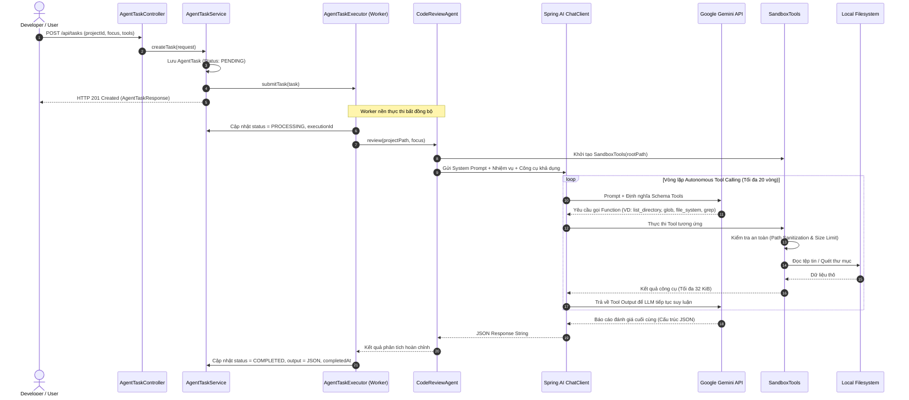
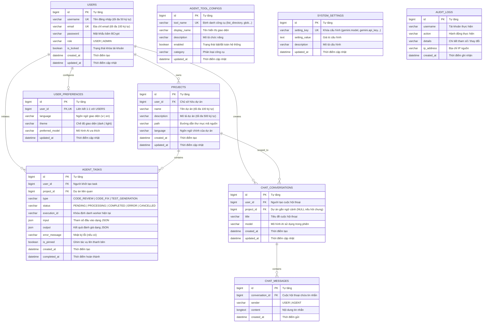

# Tài liệu Kiến trúc Hệ thống (System Architecture Document)
# Dự án: Soopi AI Agent Platform

> **Phiên bản:** 1.0.0  
> **Nền tảng:** Java 21, Spring Boot 4.1.0, Spring AI 2.0.0, Google Gemini API, MySQL 8.0, Vanilla JS Modular  
> **Tác giả:** anhzxje

---

## 1. Giới thiệu & Mục tiêu Kiến trúc

### 1.1. Giới thiệu tổng quan
**Soopi AI Agent Platform** là một nền tảng hỗ trợ đánh giá, phân tích mã nguồn (Code Review) và hội thoại kỹ thuật tự động thông qua các **Tác tử Trí tuệ Nhân tạo Độc lập (Autonomous AI Agents)**.

Khác với các công cụ chatbot thông thường chỉ xử lý các đoạn văn bản cố định hoặc dựa vào ngữ cảnh hạn chế của câu lệnh, Soopi hoạt động như một AI Agent có khả năng tự chủ:
- **Tự khám phá codebase**: Tự động duyệt thư mục, tìm kiếm tệp mã nguồn theo mẫu wildcard và đọc nội dung tệp trực tiếp từ hệ thống tệp cục bộ.
- **Tư duy và ra quyết định (Reasoning & Tool Calling)**: Lựa chọn công cụ phù hợp với từng giai đoạn phân tích mà không cần sự can thiệp thủ công từ lập trình viên.
- **Đánh giá chuyên sâu**: Phát hiện các lỗi logic, lỗ hổng bảo mật (OWASP Top 10, SQLi, Path Traversal, Memory Leaks...), đánh giá độ phức tạp và đề xuất mã nguồn khắc phục chi tiết kèm giải thích bằng tiếng Việt.

### 1.2. Các yêu cầu phi chức năng (Architectural Non-Functional Requirements)
1. **Tính Bảo mật (Security & Isolation)**:
   - Cơ chế Sandbox nghiêm ngặt chống tấn công **Path Traversal**, ngăn chặn AI Agent hoặc người dùng độc hại đọc các tệp tin hệ thống nhạy cảm bên ngoài thư mục dự án cho phép.
   - Cơ chế xác thực phi trạng thái (**Stateless JWT**) kết hợp phân quyền theo vai trò (**RBAC: USER và ADMIN**).
   - Bảo vệ chống tấn công tham chiếu trực tiếp không an toàn (**Anti-IDOR**), đảm bảo mỗi người dùng chỉ thao tác trên dữ liệu của chính mình.
2. **Tính Ổn định & Hiệu năng (Reliability & Performance)**:
   - Tác vụ AI được thực thi bất đồng bộ thông qua ThreadPool riêng biệt (`AgentTaskExecutor`), đảm bảo không nghẽn luồng xử lý web chính (Servlet Threads).
   - Giới hạn cứng dung lượng tệp tin (tối đa 256 KiB) và kích thước kết quả trả về của công cụ (tối đa 32 KiB) để bảo vệ bộ nhớ RAM và kiểm soát chi phí token LLM.
   - Cơ chế phát hiện và ngắt vòng lặp tự trị để chống cạn kiệt tài nguyên API Quota.
3. **Khả năng Mở rộng (Extensibility)**:
   - Dễ dàng bổ sung các công cụ mới (Tools) cho Agent thông qua chú thích `@Tool` của Spring AI và quản lý cấu hình bật/tắt động trong cơ sở dữ liệu.
   - Kiến trúc module hóa cho phép bổ sung các loại tác vụ mới (`TaskType`) mà không phá vỡ mô hình cơ sở dữ liệu hiện có (nhờ trường dữ liệu `JSON` linh hoạt).

---

## 2. Sơ đồ Kiến trúc Tổng thể (High-Level Architecture)

Hệ thống được thiết kế theo mô hình phân tầng hướng dịch vụ (Service-Oriented Layered Architecture):

```mermaid
graph TB
    subgraph ClientLayer ["1. Tầng Giao diện (Presentation Layer)"]
        Browser["Trình duyệt Web / Client"]
        DesktopApp["Desktop App / Web Browser (Port 8080)"]
        VanillaModules["Vanilla JS ES6 Modules<br/>(app.js, api.js, chatView.js, projectView.js, adminView.js)"]
        Browser --> VanillaModules
        DesktopApp --> VanillaModules
    end

    subgraph SecurityGateway ["2. Tầng Cổng Bảo mật (Security Gateway)"]
        SecFilter["Spring Security Filter Chain"]
        JwtFilter["JwtAuthenticationFilter"]
        PathSanitizer["Anti Path Traversal Guard"]
        VanillaModules -->|REST API / Bearer Token| SecFilter
        SecFilter --> JwtFilter
        JwtFilter --> PathSanitizer
    end

    subgraph ControllerLayer ["3. Tầng Điều khiển (REST API Layer)"]
        AuthController["AuthController (/api/auth)"]
        UserController["UserController (/api/users)"]
        ProjectController["ProjectController (/api/projects)"]
        TaskController["AgentTaskController (/api/tasks)"]
        ChatController["ChatController (/api/chat)"]
        AdminController["AdminController (/api/admin)"]
        SystemController["SystemController (/api/system)"]
        PathSanitizer --> AuthController & UserController & ProjectController & TaskController & ChatController & AdminController & SystemController
    end

    subgraph ServiceLayer ["4. Tầng Dịch vụ Nghiệp vụ (Business Logic Layer)"]
        AuthService["AuthService"]
        UserService["UserService"]
        ProjectService["ProjectService"]
        TaskService["AgentTaskService"]
        TaskExecutor["AgentTaskExecutor (Async ThreadPool)"]
        ChatService["ChatService"]
        ToolManager["ToolManagerService"]
        SysConfig["SystemConfigService"]
        AuditService["AuditLogService & AuditAspect"]

        AuthController --> AuthService
        UserController --> UserService
        ProjectController --> ProjectService
        TaskController --> TaskService
        TaskService --> TaskExecutor
        ChatController --> ChatService
        AdminController --> UserService & ToolManager & SysConfig & AuditService
        SystemController --> SysConfig & ToolManager
    end

    subgraph AgentCore ["5. Lõi AI Agent & Công cụ (AI Core & Sandbox)"]
        CodeReviewAgent["CodeReviewAgent<br/>(Reasoning & Prompt Engineering)"]
        SpringAIChat["Spring AI ChatClient"]
        SandboxTools["SandboxTools<br/>(Safe File Access)"]
        ListDir["list_directory"]
        GlobTool["glob"]
        FileSystem["file_system"]
        GrepTool["grep"]

        TaskExecutor --> CodeReviewAgent
        ChatService --> SpringAIChat
        CodeReviewAgent --> SpringAIChat
        CodeReviewAgent -->|Function Calling| SandboxTools
        SandboxTools --> ListDir & GlobTool & FileSystem & GrepTool
    end

    subgraph ExternalAndStorage ["6. Tầng Dữ liệu & Đám mây (Storage & Cloud Services)"]
        GeminiCloud["Google Gemini Cloud API<br/>(gemini-3.5-flash-lite, 2.5-flash, 2.5-pro)"]
        LocalFS["Hệ thống tệp Cục bộ<br/>(Workspace Mã nguồn An toàn)"]
        MySQL["Cơ sở dữ liệu MySQL 8.0<br/>(users, projects, agent_tasks, chat_conversations, audit_logs)"]

        SpringAIChat -->|REST / gRPC (Google AI)| GeminiCloud
        SandboxTools -->|Normalized Path I/O| LocalFS
        ServiceLayer -->|Spring Data JPA / Hibernate| MySQL
    end
```

---

## 3. Kiến trúc Phân tầng Chi tiết

### 3.1. Tầng Giao diện (Presentation Layer)
- **Công nghệ**: HTML5, Vanilla CSS3 (Custom Design System, Frosted Glass, Dark/Light Themes), Vanilla JavaScript chuẩn ES6 Modules.
- **Đặc điểm kiến trúc**:
  - Không sử dụng SPA framework nặng nề (như React hay Angular), giúp ứng dụng có thời gian khởi động tức thì, tối ưu kích thước bundle và dễ dàng tích hợp vào môi trường Desktop (Electron) hoặc nhúng.
  - Phân chia module rõ ràng:
    - [app.js](file:///d:/AI%20Agent/aiagent/src/main/resources/static/js/app.js): Bộ điều phối trung tâm (App lifecycle, định tuyến view, xử lý sự kiện toàn cục).
    - [api.js](file:///d:/AI%20Agent/aiagent/src/main/resources/static/js/api.js): Quản trị kết nối mạng RESTful, tự động đính kèm JWT Bearer Token, kiểm tra trạng thái token và điều hướng lỗi tập trung.
    - [chatView.js](file:///d:/AI%20Agent/aiagent/src/main/resources/static/js/modules/chatView.js): Quản lý luồng giao diện trò chuyện, hiển thị bong bóng tin nhắn, typing indicators, chuyển đổi model AI và ghim phiên chat.
    - [projectView.js](file:///d:/AI%20Agent/aiagent/src/main/resources/static/js/modules/projectView.js): Quản lý danh sách dự án, kích hoạt modal thêm/sửa dự án, tích hợp Native Folder Picker.
    - [adminView.js](file:///d:/AI%20Agent/aiagent/src/main/resources/static/js/modules/adminView.js): Giao diện quản trị trang cuộn đơn (Single-page Continuous Scroll) với 5 phân khu giám sát thời gian thực.
    - [markdownUtils.js](file:///d:/AI%20Agent/aiagent/src/main/resources/static/js/modules/markdownUtils.js): Trình biên dịch Markdown sang HTML an toàn, làm nổi bật cú pháp mã nguồn (Syntax Highlighting) và hỗ trợ Antigravity Slash Chips.

### 3.2. Tầng Cổng Bảo mật (Security Gateway & Filter Chain)
- **Spring Security 6 Stateless Pipeline**:
  - Mọi yêu cầu HTTP (trừ các endpoint công khai như `/api/auth/**`, `/api/system/**`, tệp tĩnh) đều phải đi qua [JwtAuthenticationFilter](file:///d:/AI%20Agent/aiagent/src/main/java/prj/anhzxje/aiagent/security/JwtAuthenticationFilter.java).
  - Filter giải mã tiêu đề `Authorization: Bearer <token>`, trích xuất username, kiểm tra tính hợp lệ về mặt chữ ký số (HMAC-SHA256) và thời gian sống (`expiration = 86400000ms = 24h`).
  - Kiểm tra trạng thái khóa tài khoản: Nếu người dùng bị Admin khóa (`isLocked == true`), Spring Security chặn yêu cầu và trả về lỗi `HTTP 403 Forbidden`.
  - Tùy biến `AuthenticationEntryPoint` và `AccessDeniedHandler` để luôn trả về cấu trúc lỗi chuẩn JSON [ErrorResponse](file:///d:/AI%20Agent/aiagent/src/main/java/prj/anhzxje/aiagent/dto/common/ErrorResponse.java).

### 3.3. Tầng Điều khiển (REST API Controllers)
- Tiếp nhận HTTP requests, kiểm tra ràng buộc dữ liệu đầu vào qua Jakarta Validation (`@Valid`, `@NotNull`, `@NotBlank`, `@Size`).
- Trả về mã phản hồi HTTP chuẩn RESTful (200 OK, 201 Created, 204 No Content, 400 Bad Request, 401 Unauthorized, 403 Forbidden, 404 Not Found, 500 Internal Server Error).
- Gắn quyền người dùng tự động từ `@AuthenticationPrincipal CustomUserDetails`.

### 3.4. Tầng Dịch vụ & Điều phối Bất đồng bộ (Service & Async Execution)
- Chứa toàn bộ quy tắc nghiệp vụ (Business Rules).
- Quản lý giao dịch cơ sở dữ liệu (`@Transactional`).
- **Thực thi tác vụ nền**: [AgentTaskExecutor](file:///d:/AI%20Agent/aiagent/src/main/java/prj/anhzxje/aiagent/service/AgentTaskExecutor.java) sử dụng `ExecutorService` chuyên dụng:
  - Khi người dùng gửi yêu cầu đánh giá mã nguồn, task được lưu vào CSDL với trạng thái `PENDING` và trả về ngay phản hồi HTTP 201 Created cho client.
  - Worker nền tiếp nhận task, chuyển trạng thái sang `PROCESSING`, gán `executionId` để phân biệt các lần chạy lại.
  - Gọi [CodeReviewAgent](file:///d:/AI%20Agent/aiagent/src/main/java/prj/anhzxje/aiagent/agent/CodeReviewAgent.java) để thực hiện vòng lặp phân tích.
  - Sau khi hoàn thành hoặc gặp lỗi, worker tự động cập nhật trạng thái `COMPLETED` (kèm kết quả JSON) hoặc `ERROR` (kèm thông điệp lỗi) vào CSDL.

---

## 4. Cơ chế Hoạt động của AI Agent & Vòng lặp Tool Calling

Mô hình hoạt động cốt lõi của tác tử AI là **Vòng lặp Phản hồi - Hành động (Perception-Reasoning-Action Loop)** được xây dựng dựa trên đặc tả Function Calling của Google Gemini và Spring AI.



### 4.1. Bộ công cụ An toàn (Sandbox Tools)
Tất cả công cụ đều là **Read-Only (chỉ đọc)**, tuyệt đối không có khả năng sửa đổi, xóa tệp tin hoặc thực thi shell command trên máy chủ:

| Tên công cụ (`@Tool`) | Lớp triển khai | Trách nhiệm | Ràng buộc An toàn |
|---|---|---|---|
| `list_directory` | `DirectoryTool` | Duyệt danh sách tệp và thư mục con bên trong dự án | Tối đa 200 mục, giới hạn 32 KiB output |
| `glob` | `GlobTool` | Tìm kiếm tệp tin theo mẫu tương đối (VD: `**/*.java`) | Quét tối đa 2000 tệp, độ sâu tối đa 20 thư mục |
| `file_system` | `ReadTool` | Đọc nội dung tệp tin văn bản mã nguồn có đánh số dòng | Tối đa 400 dòng/lần gọi, tệp không quá 256 KiB, cấm tệp nhị phân |
| `grep` | `SearchTool` | Tìm kiếm chuỗi văn bản chính xác trên toàn bộ dự án | Tìm kiếm chuỗi thuần (không regex nguy hiểm), tối đa 2000 tệp |

### 4.2. Cơ chế Bảo vệ Chống Lỗ hổng & Treo tiến trình
1. **Chống Path Traversal**:
   - Sử dụng `Path.toRealPath()` và `Path.normalize()`.
   - Bắt buộc mọi đường dẫn sau khi chuẩn hóa phải thỏa mãn điều kiện `target.startsWith(root)`.
   - Danh sách đen loại trừ tự động (`EXCLUDED`): `.git`, `.idea`, `.vscode`, `node_modules`, `target`, `build`, `dist`, `venv`, `.env`, `.env.*`, khóa SSH và chứng chỉ số.
2. **Chống Tràn RAM & Cạn kiệt Token**:
   - Giới hạn kích thước tệp tin: Không cho phép đọc tệp lớn hơn **256 KiB**.
   - Giới hạn kích thước đầu ra: Bất kỳ lệnh đọc hay tìm kiếm nào cũng bị cắt ngắn nếu vượt quá **32 KiB**.
   - Kiểm tra byte 0 (Null Byte) để ngăn chặn hoàn toàn việc nạp tệp thực thi / tệp nhị phân vào bộ nhớ ngữ cảnh của LLM.
3. **Phát hiện & Ngăn chặn Vòng lặp Vô hạn (Loop Breaker)**:
   - Trong quá trình Function Calling, nếu Agent lặp lại cùng một công cụ với cùng một tham số quá nhiều lần hoặc vượt quá giới hạn lượt tương tác tối đa (20 lượt), framework sẽ tự động ngắt và yêu cầu mô hình tổng hợp kết quả ngay lập tức.

---

## 5. Mô hình Dữ liệu Cơ sở Dữ liệu (Database ERD & Schema)

Hệ thống sử dụng cơ sở dữ liệu quan hệ **MySQL 8.0** với chuẩn mã hóa ký tự `utf8mb4` và collation `utf8mb4_unicode_ci`.



### 5.1. Cơ chế Dọn dẹp Dữ liệu Tầng sâu (Cascading Deletion)
Nhằm đảm bảo tính toàn vẹn tham chiếu và chống rác dữ liệu (Orphaned Records), hệ thống triển khai dọn dẹp theo thứ tự nghiêm ngặt khi xóa dự án hoặc xóa tài khoản:
1. **Khi xóa một Dự án (`DELETE /api/projects/{id}`)**:
   - Dọn dẹp toàn bộ tin nhắn chat thuộc các cuộc hội thoại gắn với dự án này.
   - Xóa toàn bộ các phiên hội thoại (`chat_conversations`) của dự án.
   - Xóa toàn bộ các tác vụ AI (`agent_tasks`) của dự án.
   - Xóa bản ghi dự án trong bảng `projects`.
2. **Khi Quản trị viên xóa một Người dùng (`DELETE /api/admin/users/{userId}`)**:
   - Xóa tất cả các tác vụ AI của người dùng trên toàn bộ các dự án.
   - Xóa toàn bộ tin nhắn và phiên chat của người dùng.
   - Xóa toàn bộ các dự án do người dùng sở hữu.
   - Xóa cấu hình tùy chọn cá nhân (`user_preferences`).
   - Xóa bản ghi tài khoản người dùng trong bảng `users`.
   - Ghi nhật ký vào bảng `audit_logs` để thanh tra.

---

## 6. Kiến trúc Bảo mật Đa Tầng (Defense-in-Depth Security)

Hệ thống áp dụng mô hình bảo mật 5 lớp:

1. **Lớp 1: Mã hóa và Lưu trữ Mật khẩu An toàn**:
   - Sử dụng thuật toán **BCrypt** với độ phức tạp cao (`BCryptPasswordEncoder`).
   - Mật khẩu gốc không bao giờ được ghi vào log hay truyền ra ngoài giao diện.
2. **Lớp 2: Xác thực Phi trạng thái (Stateless JWT)**:
   - Token được ký điện tử bằng khóa bí mật HMAC-SHA256 (`jwt.secret`) có độ dài tối thiểu 256 bits.
   - Header chuẩn: `Authorization: Bearer <JWT_TOKEN>`.
3. **Lớp 3: Phân quyền theo Vai trò (RBAC) & Chống IDOR**:
   - Toàn bộ API nghiệp vụ đều kiểm tra quyền sở hữu dựa trên `user_id` lấy từ token đã xác thực thay vì tin tưởng tham số do client gửi lên.
   - Các API quản trị (`/api/admin/**`) được bảo vệ bằng `@PreAuthorize("hasRole('ADMIN')")`.
4. **Lớp 4: Cơ chế Sandbox Hệ thống Tệp**:
   - Ngăn chặn hoàn toàn việc thoát khỏi thư mục dự án thông qua kỹ thuật chuẩn hóa đường dẫn và kiểm tra biên (`Path.toRealPath()` và `Path.startsWith()`).
   - Cấm truy cập các tệp cấu hình chứa secret (`.env`, `.env.production`) và thư mục hệ thống.
5. **Lớp 5: Che giấu Khóa Bí mật & Nhật ký Kiểm toán (Secret Masking & Audit Trail)**:
   - Gemini API Key được che giấu dạng mặt nạ (`AIzaSy...4X9Z`) trước khi trả về bảng điều khiển Admin.
   - Mọi hành vi nhạy cảm (Đăng nhập, Khóa tài khoản, Bật/Tắt tool, Cập nhật API key) đều được tự động lưu vết qua Spring AOP / `AuditLogService` kèm địa chỉ IP và dấu thời gian.

---

## 7. Các Quyết định Công nghệ Quan trọng (Key Design Decisions)

| Hạng mục | Công nghệ lựa chọn | Lý do lựa chọn & Lợi ích kiến trúc |
|---|---|---|
| **Ngôn ngữ & Runtime** | Java 21 LTS | Hỗ trợ tính năng hiện đại (Pattern Matching, Switch Expressions, Record classes, Virtual Threads), hiệu năng thực thi cao, quản lý bộ nhớ mạnh mẽ. |
| **Framework** | Spring Boot 4.1.0 | Hệ sinh thái hoàn chỉnh, hỗ trợ cấu hình hiện đại, tối ưu hóa thời gian khởi động và tương thích hoàn toàn với Spring AI 2.0.0. |
| **AI Framework** | Spring AI (`spring-ai-starter-model-google-genai`) | Tích hợp native với mô hình Function Calling của Google Gemini, cung cấp abstraction mạnh mẽ qua `ChatClient`, không phụ thuộc vào Python runtime. |
| **Cơ sở dữ liệu** | MySQL 8.0 + Hibernate | Hỗ trợ kiểu dữ liệu JSON cột nguyên bản (`SqlTypes.JSON`), hỗ trợ transaction ACID chuẩn, đảm bảo tính toàn vẹn cho hệ thống đa người dùng. |
| **Frontend Architecture** | Vanilla JS ES6 Modules | Loại bỏ hoàn toàn sự cồng kềnh của Webpack/Vite/Node modules ở phía client. Mã nguồn nhẹ, chạy trực tiếp từ Spring Boot static resources, hiệu năng tải trang tức thì. |
